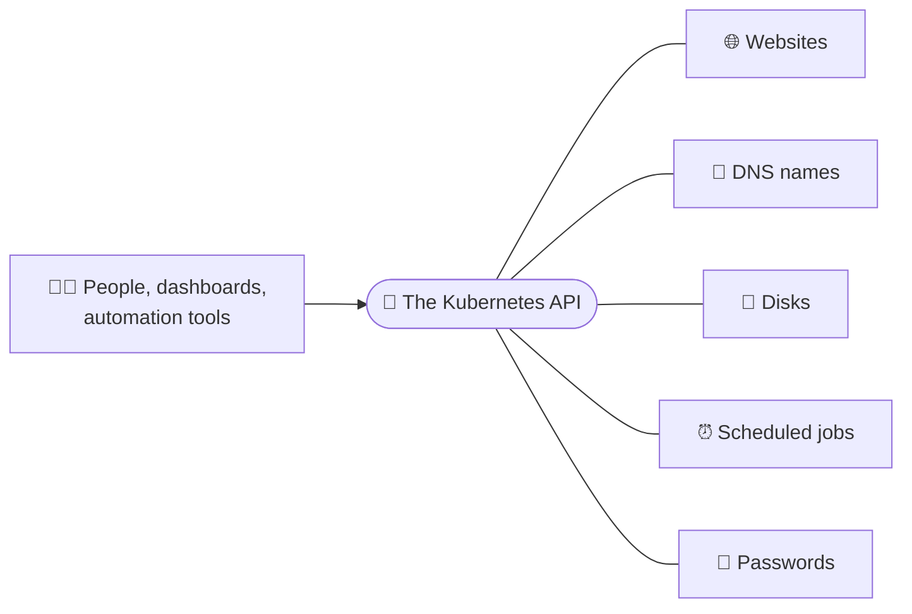
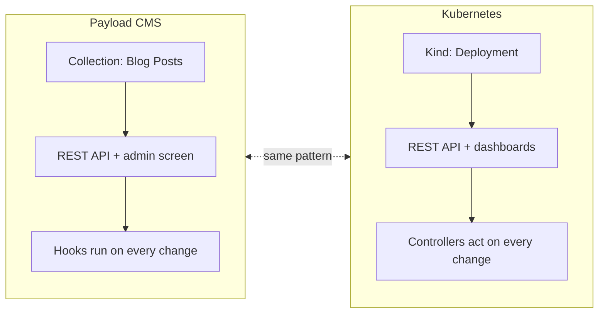

# 3. Kubernetes is an API

Most people describe Kubernetes as "a container platform". That is true,
but it misses the part that matters most for our business. **Kubernetes is
an API.** Running containers is just the first thing that API happened to
know how to do.

## One front door for everything

Think of how a Windows Server is managed. IIS has IIS Manager. DNS has the
DNS console. Disks have Disk Management. Users have Active Directory Users
and Computers. Scheduled jobs have Task Scheduler. Each part has its own
tool, its own screen and its own way of doing things, and a person usually
has to Remote Desktop in to use them.

Kubernetes has **one front door**: a single API. Every part of the system,
whether it is a website, a disk, a DNS name, a password or a scheduled job,
is managed through that same door, in the same way.

## Everything is a record

You already know APIs: a client sends a request to a URL, like *"give me
customer 42"* or *"create a new order"*, and gets an answer back.

The Kubernetes API works the same way, and **everything in it is a record
of a certain type**. Kubernetes calls the types *kinds* and the records
*resources* (or *objects*). A few of the built-in kinds:

| Kind (the "type") | What one record means | Windows-world comparison |
| --- | --- | --- |
| **Pod** | One running copy of an app (one or more containers) | A running w3wp.exe worker process |
| **Deployment** | "Keep N copies of this app running, at this version" | An IIS site + app pool, plus someone watching it |
| **Service** | A stable name and address for a group of copies | A DNS name pointing at a load balancer |
| **Secret** | A password, key or certificate | Credentials in the Windows Credential Manager |
| **PersistentVolumeClaim** | "I need 20 GB of disk" | Asking the storage team for a new drive letter |
| **CronJob** | "Run this every night at 2 a.m." | A Task Scheduler task |
| **Namespace** | A folder that groups records, per team or per customer | A separate IIS server per client |

Every one of these is just **a record you create, read, update or delete**
through the API (often called CRUD, the same four verbs as SQL's INSERT,
SELECT, UPDATE and DELETE).

## You already know this pattern: Payload CMS

Payload CMS is the best comparison you have, because it works almost
exactly like Kubernetes.

In Payload, a developer defines a **collection**, say *Blog Posts*, with
fields like title, author and body. Payload then gives you, for free:

- a database table for the posts,
- a full REST API to create, read, update and delete posts,
- an admin screen to manage them,
- and *hooks*, little programs that run whenever a post changes.

Kubernetes does the same thing, but for **infrastructure** instead of
content. Its built-in "collections" are Pods, Deployments, Services and the
rest. Each one comes with an API, storage, and a controller (the thermostat
from [chapter 1](big-idea.md)) that acts whenever a record changes.

## Why "it is an API" matters to the business

- **Every tool speaks the same language.** Dashboards, the command line,
  automation, monitoring and deployment tools like Argo CD or Flux all read
  and write the same records through the same API. No screen scraping, no
  RDP, no "only Bob knows how to configure that".
- **The work order is the documentation.** The records describing our
  systems are saved in git (version control) like source code. We always
  know what is running, who changed it, when, and why, and we can roll
  back.
- **It runs the same anywhere.** The API is identical on Azure, AWS,
  Google Cloud, or our own servers. The work order does not change when the
  hardware does.

And the most important one, which gets its own chapter:

- **We can add our own collections.** Exactly like adding a new collection
  to Payload, we can add brand new kinds of records to Kubernetes. That is
  what makes it *the extensible API*.

[Next: Teaching the API new tricks :material-arrow-right:](extending.md){ .md-button .md-button--primary }
