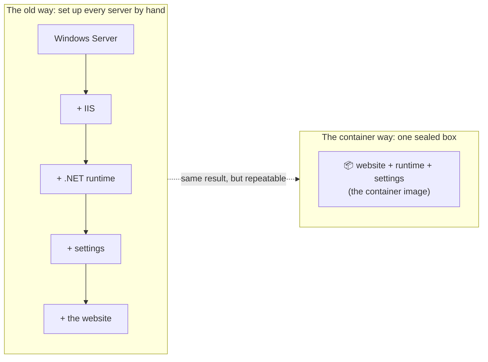
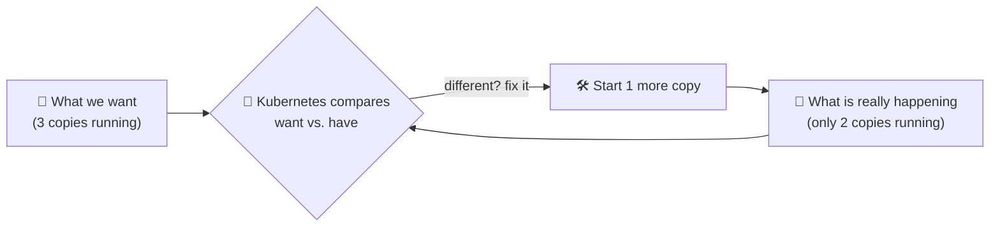

# 1. The big idea

Before Kubernetes makes sense, two smaller ideas need to click: the
**container**, and **desired state**.

## Containers: the whole server in a box

Think about what it takes to put a DotNetNuke site on a new Windows Server.
Install the right Windows features, install IIS, install the right .NET
version, set up the application pool, copy the site files, set permissions,
edit `web.config`, and hope the new server matches the old one. If one
step differs, the site breaks in a way that "works on my machine".

A **container** packs the application *together with everything it needs to
run* into one sealed box: the program, the runtime, the settings, the
libraries. The box runs the same way on a laptop, in our server room, or in
Azure.

!!! tip "The shipping container comparison"
    Before shipping containers, every ship was loaded by hand, crate by crate,
    and every port worked differently. The steel shipping container made
    cargo a standard shape, so any crane, ship, train or truck can move it.
    Software containers did the same for programs. That is why the logo of
    Docker is a whale carrying containers, and the logo of Kubernetes is a
    ship's wheel: *Kubernetes* is Greek for "helmsman", the person who steers
    the ship.

!!! note "You do not need Docker on your PC for any of this"
    Docker is one tool for *making* containers. Kubernetes *runs* them, on
    servers. Installing Docker Desktop on Windows is fiddly (it needs a
    Linux layer underneath), which is exactly why it failed. It is not
    needed to understand, plan or manage a Kubernetes project.

## Kubernetes: the operations team that never sleeps

One container is easy to run. A real system is hundreds of them, spread
across many servers, and servers fail, get patched and run out of space.
Someone has to decide which server runs what, restart what crashes, and
move work away from a server that is down.

Kubernetes is that someone. You give it a **work order** that says *what you
want*, not *how to do it*:

> "Run 3 copies of the customer portal, version 2.4, reachable at
> portal.example.com, with 20 GB of storage."

Kubernetes then makes it so, and **keeps** it so.

## Desired state: the thermostat

This is the most important idea on this page.

A thermostat does not take orders like "run the furnace for 10 minutes".
You tell it *the result you want*, 70°F, and it keeps checking the room
and correcting it, forever, without being asked again.

Kubernetes works exactly like the thermostat. That checking loop is
called a **control loop**, and the little program running it is called a
**controller**. If a server dies at 3 a.m., the copies that were on it are
missing, the controller notices the difference, and starts replacements on
a healthy server. Nobody gets paged.

!!! example "As a project manager, this changes the conversation"
    With Windows Server, a runbook says *"if the site goes down, RDP into the
    server, check the app pool, restart IIS"*. With Kubernetes, the runbook is
    replaced by the work order itself. The team writes down **what good looks
    like**, and the platform does the restarting, moving and replacing.

## Where the rest of this site goes

The thermostat idea, *describe what you want and a controller makes it
true*, is not limited to running containers. Kubernetes lets us apply it to
**anything**: databases, cloud servers, VPNs, Windows virtual machines.
That is what makes it an *extensible API* and a *platform that develops
itself*, and it is what the next two chapters are about.

[Next: Kubernetes is an API :material-arrow-right:](api.md){ .md-button .md-button--primary }
