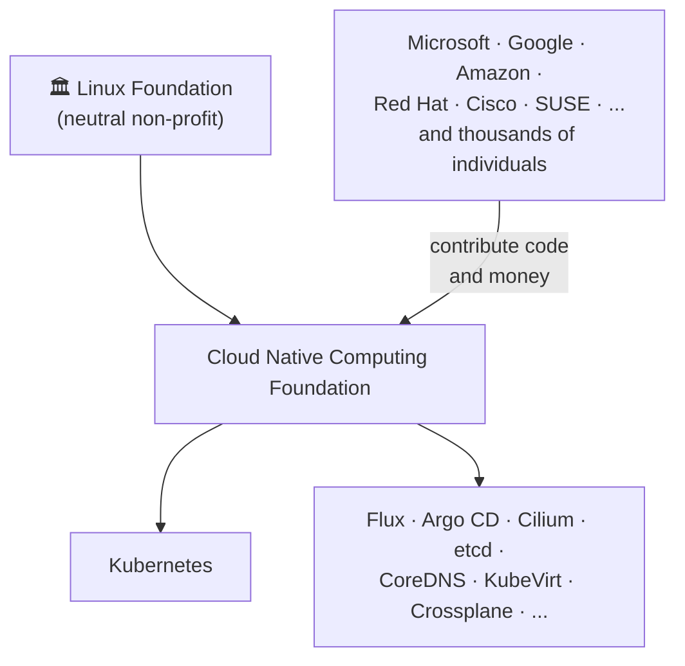
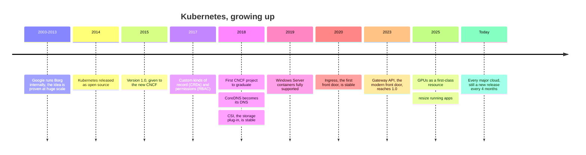

# 6. Community and ownership

This is the most important chapter. Technology comes and goes; what makes
Kubernetes a safe, long-term bet is **who builds it, who owns it, and how it
keeps getting better**.

## "I have never heard of it" does not mean "small"

Names like Argo CD, Flux, Cilium, KubeVirt, Crossplane or KRO are not
household names, even among IT people who grew up on Windows. That is
because they live one layer below the products people see. But they are not
hobby projects. They are built and run by the largest technology companies
on earth, and the most valuable software in the world runs on them.

| Project | What it does for us | Who is behind it |
| --- | --- | --- |
| **Kubernetes** | The platform itself | Started at Google, now thousands of companies |
| **Argo CD** | Deploys from git, automatically | Grown up at **Intuit** (TurboTax, QuickBooks) |
| **Flux** | Deploys from git, automatically | Used by **Microsoft** for GitOps in Azure (AKS and Azure Arc) |
| **Cilium** | Networking, security, load balancing | Created by Isovalent, now part of **Cisco**; built into **Google** GKE and **Azure** networking |
| **KubeVirt** | Virtual machines, including Windows | Started by **Red Hat** (IBM); powers OpenShift Virtualization |
| **Crossplane** | Manages cloud resources from Kubernetes | Created by Upbound; a CNCF **Graduated** project since 2025 |
| **KRO** | New API endpoints without code | Started jointly by **Amazon, Google and Microsoft** |
| **CloudNativePG** | PostgreSQL databases | Created by **EDB**, one of the main PostgreSQL companies |
| **k3s / RKE2** | The Kubernetes we install | **SUSE Rancher**; RKE2 is built for US government security standards |
| **OpenTofu** | Infrastructure as code | The **Linux Foundation**; a CNCF project since 2025 |

## How the CNCF grades its projects

Most of these projects live in the **Cloud Native Computing Foundation
(CNCF)**, part of the Linux Foundation. The CNCF only moves a project up a
level after checking it, a bit like vendor due diligence:

| Level | What it takes | What it means for us |
| --- | --- | --- |
| 🌱 **Sandbox** | Accepted by the CNCF; a neutral home and open governance. Early, may change a lot. | Try it at the edges. |
| 🌿 **Incubating** | Used in production by at least three independent companies; a healthy, growing team; steady releases. | Use it, and keep an eye on it. |
| 🌳 **Graduated** | An independent security audit; maintainers from several companies; a public list of production users; formal governance. | Build the business on it. |

## When our projects joined the CNCF

| Project | Started | Joined the CNCF | Graduated |
| --- | --- | --- | --- |
| Kubernetes | 2014, Google | 2016 (its first project) | 2018 |
| etcd | 2013, CoreOS | 2018 | 2020 |
| CoreDNS | 2016 | 2017 | 2019 |
| Envoy (and Envoy Gateway) | 2016, Lyft | 2017 | 2018 |
| Flux | 2016, Weaveworks | 2019 | 2022 |
| KubeVirt | 2017, Red Hat | 2019 | incubating |
| Argo | 2017, Applatix (later Intuit) | 2020 | 2022 |
| Crossplane | 2018, Upbound | 2020 | 2025 |
| Cilium | 2016, Isovalent | 2021 | 2023 |
| CloudNativePG | 2022, EDB | 2025 | sandbox |
| OpenTofu | 2023, from Terraform | 2025 | sandbox |

## Our rule: CNCF on the pathway

The **pathway** is everything a customer's order passes through: our
portal, the Kubernetes API, KRO, Crossplane, the network and the site
itself. Our rule for it:

1. **Only CNCF projects** (or Kubernetes itself) on the pathway.
2. **Prefer Graduated** for anything critical.
3. **Incubating** where needed, and watched.
4. **Sandbox** only off the critical path, or with a way out.

Where our stack stands today:

| Level | Projects |
| --- | --- |
| 🌳 Graduated | Kubernetes, etcd, CoreDNS, Cilium, Envoy (including Envoy Gateway), Crossplane (2025), Argo, Flux |
| 🧩 Part of Kubernetes itself | KRO, Gateway API |
| 🌿 Incubating | KubeVirt (heading for graduation) |
| 🌱 Sandbox | CloudNativePG, OpenTofu, k3s, OpenEBS |
| ➖ Not CNCF (open source, company-backed) | RKE2 |

With Envoy Gateway as the front door, the whole pathway is Graduated or
part of Kubernetes itself.

## Open source is where the important software lives

Open source can sound like "free software made by volunteers". Today it
means something different: **software built in public by companies that
compete with each other, because sharing the foundation is cheaper and
better than each building their own.**

You already rely on it:

- **DotNetNuke** (DNN Platform) is open source.
- **Payload CMS** is open source.
- **.NET** itself has been open source since 2016, and Microsoft owns
  **GitHub**, the largest home for open source in the world.

Why building in the open brings more value to a business:

- **More eyes, fewer surprises.** Security problems are found and fixed in
  public, by thousands of reviewers, not hidden until a vendor decides to
  patch.
- **No lock-in.** If a vendor raises prices or disappears, the code is still
  there and someone else can support it.
- **Easier hiring.** Engineers already know the tools. Nobody needs to learn
  a proprietary product from scratch.
- **Free improvements.** When another company fixes a bug or adds a
  feature, we get it too.
- **Reputation.** Work done in the open shows customers and future hires
  what we can do.

That is why we build in the open as much as possible, the same way
Kubernetes is built.

## Owned by a foundation, not a company

Kubernetes is not owned by Google, even though Google started it. In 2015
Google gave it to the **Cloud Native Computing Foundation**, part of the
**Linux Foundation**, a neutral non-profit. Its members include Microsoft,
Google, Amazon, IBM / Red Hat, Oracle, Cisco and hundreds more.

!!! warning "Why this matters: a real story"
    In 2023, the company behind **Terraform**, a very popular tool for
    managing cloud infrastructure, changed its license so competitors could
    no longer use it freely. Because the code was open, the community made a
    copy, **OpenTofu**, and gave it to the Linux Foundation, where no single
    company can do that again. That is the tool our cloud controller uses.
    **A foundation-owned project cannot be taken away from its users.**
    Kubernetes has had that protection from the start.

## It gets better underneath us

Kubernetes was first released in **2014**, built on more than ten years of
Google running its own internal version (called Borg). It is over a decade
old, it is here to stay, and it is only now hitting its stride:

- A **new release every four months**, like clockwork, with a published
  schedule and support window.
- Each release brings improvements we get **just by upgrading**: better
  networking (Gateway API replaced the older Ingress), Windows container
  support, resizing running apps without restarting them, first-class
  support for GPUs and AI workloads.
- Every operator we use improves on its own schedule too: a new CloudNativePG
  version means better databases for every tenant, without any work from
  our team.
- More companies support it every year: every major cloud, every major
  hardware vendor, every major security and monitoring product.

!!! quote "The short version"
    When we build on Kubernetes, we are not betting on a product. We are
    joining the place where the whole industry has decided to work together,
    and every year the platform underneath us gets better because of it.

[Next: Our platform :material-arrow-right:](our-platform.md){ .md-button .md-button--primary }
