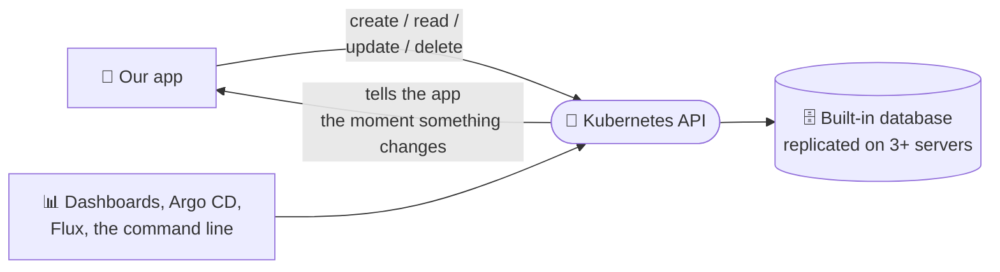

# 4. A database built in

Every record from the last two chapters, every Deployment, every Secret,
every custom "Tenant" or "PostgresCluster", has to be stored somewhere. That
somewhere is a database that ships inside Kubernetes. Which means
**Kubernetes is also a database**, and our applications can use it.

## A key-value store: the simplest kind of database

Kubernetes keeps its records in **etcd** (said "et-see-dee"), a
*key-value store*. If you picture a SQL table with only two columns, you
have it:

| Key (the "address" of the record) | Value (the record itself) |
| --- | --- |
| /deployments/acme/customer-portal | 3 copies, version 2.4, ... |
| /secrets/acme/database-password | (encrypted) |
| /tenants/acme | plan: Gold, region: US-East |

!!! tip "You have used one before"
    The Windows **Registry** is a key-value store: a path like
    `HKEY_LOCAL_MACHINE\SOFTWARE\...` pointing to a value. etcd is the same
    idea, made reliable enough to run a data center.

!!! note "And sometimes it really is SQL"
    **k3s**, the lightweight Kubernetes we run at the edge, can store its
    records in **SQLite, PostgreSQL or MySQL** instead of etcd. Same API on
    top, a SQL database underneath.

## What it gives us that a plain database does not

The API sits in front of the store, so every record gets features we would
otherwise have to build ourselves:

| Feature | What it means | SQL Server comparison |
| --- | --- | --- |
| **Replicated** | Kept on 3 or 5 servers at once; losing one loses nothing | An Always On availability group |
| **Watch** | Programs are *told* the moment a record changes, no polling | Triggers or change tracking |
| **Versioned** | Two people cannot overwrite each other's change by accident | A rowversion column |
| **Schema checked** | A record with a wrong or missing field is refused | Column types and constraints |
| **Permissions** | Who may read or change which kinds, per folder | GRANT / DENY on tables |
| **Audit log** | Who changed what, and when | SQL Server Audit |

The **watch** feature is what makes the thermostat from
[chapter 1](big-idea.md) possible: a controller does not have to keep
asking "did anything change?". It is notified instantly.

## Our applications can use it too

An application built for Kubernetes can keep its own small, important data
as records in this API: its settings, the list of customers it serves,
feature switches, the state of a long-running job. It gets replication,
change notifications, permissions and auditing for free, without anyone
setting up or maintaining a separate database for it.

!!! warning "Right tool for the job"
    The built-in database is for **small, important records**: configuration
    and state, not millions of orders or customer files. Big business data
    still belongs in a real database, and thanks to operators like
    CloudNativePG ([chapter 3](extending.md)), getting one of those is just
    another work order.

[Next: The plumbing comes free :material-arrow-right:](plumbing.md){ .md-button .md-button--primary }
