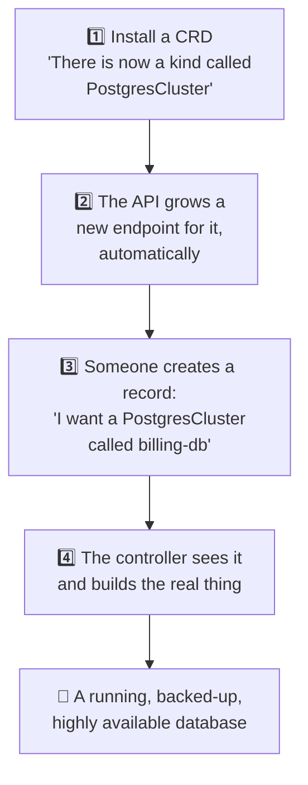
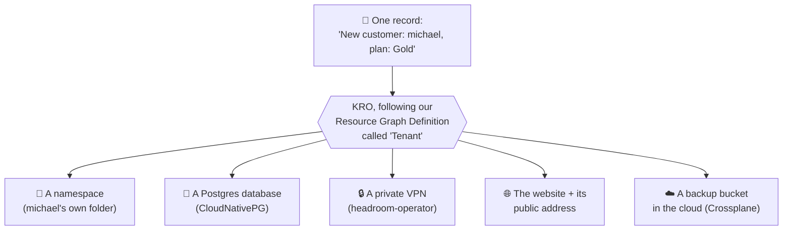

# 3. Teaching the API new tricks

This chapter is the heart of the headline: **the extensible API, a platform
that develops itself.**

[Chapter 2](api.md) showed that Kubernetes comes with built-in kinds of
records (Pods, Deployments, Services) and a controller for each one that
keeps reality matching the record. The big idea here is that **we can add
our own kinds**, and they become first-class citizens of the API, exactly
as if Kubernetes had shipped with them.

## Three words, three comparisons

| Kubernetes word | What it means | Payload CMS comparison |
| --- | --- | --- |
| **CRD** (Custom Resource Definition) | The definition of a brand new kind of record: its name and its fields | Defining a new collection |
| **Custom resource** | One record of that new kind | One entry in that collection |
| **Controller** | The thermostat that makes the real world match each record | A hook that runs on every change |

Put a CRD and its controller together, package them so anyone can install
them, and you have an **operator**.

!!! tip "An operator is an expert in a box"
    Think of the best database administrator you have ever worked with: the
    one who knows how to set up replication, take backups, test restores,
    fail over at 3 a.m. and upgrade without downtime. An **operator** is that
    person's knowledge written down as a program, running 24/7 inside the
    cluster. You file a work order ("I want a Postgres database with 2
    standby copies and nightly backups") and the operator does everything the
    expert would have done, and keeps doing it.

## What adding a CRD looks like

Nobody had to change Kubernetes itself. Nobody had to wait for a vendor's
next release. The new endpoint is managed with the **same tools, same
permissions, same history in git and same dashboards** as everything else.

## What it looks like: new routes on our API

You already know HTTP routes like `/api/blog-posts/42` from Payload. Every
Kubernetes record lives at a route too, and it always reads the same way:

| Part of the route | Example | Means |
| --- | --- | --- |
| who added it | `kubevirt.io` | the project that taught Kubernetes this route |
| version | `v1` | which version of that route |
| folder | `namespaces/dev-team` | whose it is: usually one folder per team or customer |
| kind of thing | `virtualmachines` | like a table name, or a Payload collection |
| one record | `sql-01` | like a row id |

So `GET /apis/kubevirt.io/v1/namespaces/dev-team/virtualmachines/sql-01` simply
means *"show me dev-team's Windows SQL server"*.

Every Kubernetes starts with built-in routes. Each thing we install adds
more, and they work exactly like the built-in ones:

| Route (`{namespace}` = whose folder) | What lives there | Added by |
| --- | --- | --- |
| `/api/v1/namespaces/{namespace}/pods` | running copies of an app | built in |
| `/apis/apps/v1/namespaces/{namespace}/deployments` | "keep N copies running" | built in |
| `/api/v1/namespaces/{namespace}/secrets` | passwords, certificates | built in |
| `/apis/postgresql.cnpg.io/v1/namespaces/{namespace}/clusters` | Postgres databases | CloudNativePG |
| `/apis/kubevirt.io/v1/namespaces/{namespace}/virtualmachines` | Windows Server VMs | KubeVirt |
| `/apis/argoproj.io/v1alpha1/namespaces/{namespace}/workflows` | multi-step jobs and pipelines | Argo Workflows |
| `/apis/gateway.networking.k8s.io/v1/namespaces/{namespace}/httproutes` | website front doors | Gateway API (Envoy Gateway) |
| `/apis/gateway.envoyproxy.io/v1alpha1/namespaces/{namespace}/securitypolicies` | front-door logins and security | Envoy Gateway |
| `/apis/infra.contrib.fluxcd.io/v1alpha2/namespaces/{namespace}/terraforms` | cloud infrastructure via OpenTofu | Flux OpenTofu controller |
| `/apis/compute.gcp.upbound.io/v1beta1/instances` | Google Cloud servers | Crossplane |
| `/apis/kro.run/v1alpha1/namespaces/{namespace}/tenants` | a whole new customer (ours) | KRO, no code |

Nobody rebuilt or restarted Kubernetes to get those routes. Logins,
permissions, history and dashboards all work on them from the moment
they appear.

## Real examples, all of which we can use

Every row below is a new kind of record that someone added to the
Kubernetes API. Install it, and our platform can suddenly do something it
could not do yesterday.

| We file a work order for... | What makes it real | What happens |
| --- | --- | --- |
| :material-cloud: **Cloud servers, networks, buckets** on Google Cloud, AWS or Azure | **Crossplane**, or the **Flux OpenTofu controller** | The controller calls the cloud provider's own API to create, update or delete the resources, and fixes any drift. Our Kubernetes API becomes a remote control for every cloud. |
| :material-elephant: **A PostgreSQL database** | **CloudNativePG** operator | A primary database plus standby copies, automatic failover, scheduled backups and point-in-time restore. |
| :material-vpn: **A private VPN for one customer**, hosted on our own servers | **headroom-operator** | Each tenant gets their own isolated VPN, created and torn down from a single record. |
| :material-microsoft-windows: **A Windows Server virtual machine** | **KubeVirt** | A real Windows VM, running on the same servers and managed through the same API as the containers next to it. |
| :material-robot: **A safe sandbox for an AI agent** | **NVIDIA OpenShell** on Kubernetes | An isolated, locked-down space where an AI agent can work without touching anything it should not. |
| :material-paperclip: **A Paperclip instance** | the **Paperclip operator** | A ready-to-use Paperclip, created, upgraded and backed up from one record. |
| :material-minecraft: **A Minecraft server** | **our own CRD** | "A world for the grandkids, 10 players": the server, its disk and its address, from one record. |
| :material-language-csharp: **A .NET app** | built in (*Deployment*) | Three copies always running, replaced when they crash, updated one at a time. |

!!! example "The cloud example, in plain words"
    Normally, to create a database in Azure, someone logs into the Azure
    portal or runs Azure's tools. With Crossplane installed, we create a
    record in *our own* Kubernetes API that says "I want an Azure SQL
    database, this size, in this region". The controller talks to Azure for
    us. If someone deletes or changes it by hand in the portal, the
    controller puts it back, just like the thermostat. Swap the record for a
    Google Cloud or AWS one and the process is identical.

## KRO: building new endpoints without writing code

Operators are powerful, but each one is a program someone had to write.
**KRO** (Kube Resource Orchestrator) removes that step for the most common
case: *"when someone asks for X, create these five things, wired together"*.

With KRO we write a **Resource Graph Definition**: a recipe that says what
the new kind of record is called, what questions it asks, and which existing
records it should create. KRO reads the recipe, **adds the new kind to the
API on the spot, and acts as its controller**. No programming, no
compiling, no deploying a new program.

!!! tip "The SQL comparison"
    A Resource Graph Definition is a bit like a SQL **view** or **stored
    procedure** that a non-programmer can write: one simple thing on the
    outside, several real tables being filled in on the inside. Except here
    the "tables" are databases, networks, VPNs and cloud servers.

!!! info "Who builds KRO?"
    KRO was started together by **Amazon (AWS), Google and Microsoft**, three
    companies that normally compete for the same customers. It now lives
    inside the official Kubernetes project ("kubernetes-sigs"). When the three
    biggest cloud companies agree on a tool, that is a strong signal.

## Why this is "a platform that develops itself"

- Every operator someone else publishes is a new capability **we can install
  in minutes**, instead of building it.
- Every capability we build ourselves, like the "Tenant" above, becomes a
  **product on our own API**. The next team or customer just files a work
  order.
- Our people stop clicking through consoles and start describing outcomes.
  The platform does the repetitive work, the same way every time.
- And because the extension mechanism is built into Kubernetes, the
  improvements keep coming from the whole world, not only from us. That is
  the subject of [chapter 6](community.md).

[Next: A database built in :material-arrow-right:](database.md){ .md-button .md-button--primary }
