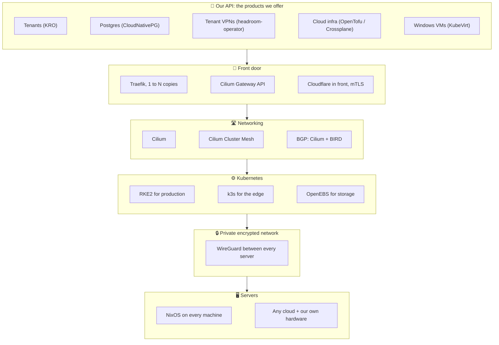
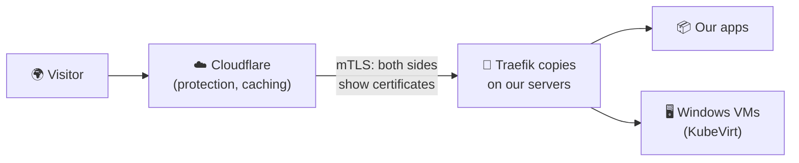

# 7. Our platform

The first six chapters were about Kubernetes in general. This one is about
**how we run it**: which pieces we picked, and why. Each layer sits on the
one below it, like floors in a building.

## Floor 1: the servers run NixOS

Every server, in any cloud or in our own racks, runs **NixOS**, a version of
Linux where **the entire server is described in one set of text files**:
every program, every setting, every user, every firewall rule.

!!! tip "In Windows terms"
    Imagine a Windows Server install image, all of its Group Policy, every
    installed feature and every configuration change, written down in a single
    document. Hand that document to a blank machine and you get an identical
    server, every time. Made a bad change? Pick yesterday's version from the
    boot menu and you are back.

**Nothing reaches production untested.** Every change to our RKE2 and k3s
setup is first tried in a full suite of automated tests that builds whole
clusters out of virtual machines and checks they work. Only then does it
touch a real server. Think of a brand-new staging environment, built from
scratch and thrown away, for every single change.

## Floor 2: one private, encrypted network everywhere

Every server connects to every other one over **WireGuard**, a modern,
very fast encrypted tunnel (a VPN between servers), set up by NixOS itself.

- All traffic between servers is **encrypted**, always, everywhere.
- Servers in **different clouds and in our own buildings** join the **same
  private network**, so one cluster can mix Azure, Google Cloud, AWS and
  on-premises machines.
- The design is **"layer 3 only"**: servers are connected by routing
  (addresses and routes), not by stretching one big office-style network
  between locations. It is simpler, scales further, and works the same
  across any provider.

## Floor 3: Kubernetes itself

| Where | What we run | Why |
| --- | --- | --- |
| Big production servers | **RKE2** (from SUSE Rancher) | Hardened, security-focused Kubernetes built for government standards |
| Small sites, "the edge" | **k3s** (from SUSE Rancher) | The same Kubernetes API in a single small program, for small machines |
| Disks | **OpenEBS** | Storage for apps, built from the disks in our own servers |
| Virtual machines | **KubeVirt** on bare-metal servers | Windows and other VMs, managed by the same API |

Because RKE2 and k3s are both real Kubernetes, **everything on this site
works the same on both**.

## Floor 4: networking with Cilium

We use **Cilium** as our only network plugin. It connects every app to every
other app, enforces who may talk to whom, and does it very efficiently
inside the Linux kernel.

- **Cilium Cluster Mesh** joins several clusters together, so apps in one
  cluster can find and reach apps in another, as if they were one big
  cluster.
- **BGP**, the language routers on the internet use to tell each other "this
  address lives over here", is spoken by our own servers through the
  **Cilium BGP control plane** and **BIRD**. That lets us create our own
  load balancer addresses from the servers' own IP addresses, with no
  hardware load balancer to buy.

!!! example "Every server is a router"
    Each server is also a router and a front-door proxy. **Adding a server
    adds routing and front-door capacity automatically.** On the old Windows
    model, more traffic meant buying a bigger F5. Here it means adding a
    node.

## Floor 5: the front door

Visitors come in through **Traefik**, our preferred front-door proxy
(reverse proxy).

- We run **1 to N copies of Traefik**, each with a public or private
  load balancer address provided by Cilium BGP.
- **Every protocol is supported**: HTTP, HTTPS, TCP, UDP, TLS, mutual TLS
  (mTLS) and QUIC (the fast protocol behind HTTP/3).
- **Cloudflare** sits in front of our public sites. Using Traefik's own
  record types (like *IngressRoute*), Traefik only accepts connections that
  prove they really come from Cloudflare (that proof is **mTLS**: both sides
  show a certificate). Nobody can go around Cloudflare's protection.
- We prefer the newer **Gateway API** over the older Ingress, and also use
  **Cilium's Gateway API** support.

## Floor 6: our own API

On top of everything, we add the products from [chapter 3](extending.md):
tenants, databases, VPNs, cloud infrastructure and virtual machines, each
one a new kind of record in our own Kubernetes API, many of them defined
with KRO and no code at all.

!!! quote "Putting it all together"
    A new customer is one record. The platform creates their folder, their
    database, their VPN, their website and their front-door address, on
    whichever cloud or building we choose, encrypted end to end, tested
    before it ever ran in production, and kept healthy around the clock.
    **That is a platform that develops itself.**

[Next: Example, Payload CMS sites :material-arrow-right:](payload-sites.md){ .md-button .md-button--primary }
