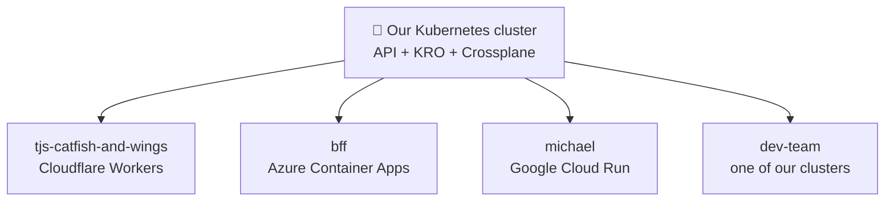
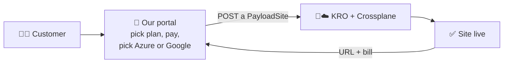

# 8. Example: Payload CMS sites as a product

This chapter puts everything together into one real product: **a Payload
CMS website for a customer, ordered with one request, running on whichever
cloud they choose.** The customer never sees Kubernetes; our platform does
all the work.

## The order form: a PayloadSite route

With KRO ([chapter 4](extending.md)) we add our own route to the API,
`payloadsites`. One record is one customer's Payload CMS site, and it reads
like a short form:

```yaml
apiVersion: kro.run/v1alpha1
kind: PayloadSite
metadata:
  name: main-site
  namespace: tjs-catfish-and-wings   # the tenant's folder
spec:
  domain: tjscatfishandwings.com
  target: cloudflare-workers         # where it runs (7 choices, below)
  size: small                        # small | medium | large
```

Creating it is one request:
`POST /apis/kro.run/v1alpha1/namespaces/tjs-catfish-and-wings/payloadsites`.
(`kro.run` is KRO's default group; it can carry our company's name instead.)

## Seven places a PayloadSite can run

Payload CMS needs somewhere to run, a database, and a place for uploaded
media. The same three fields build all of it, wherever the customer picked:

| Target | Payload runs on | Database + media files |
| --- | --- | --- |
| `cloudflare-workers` | Cloudflare Workers | D1 + R2 |
| `cloud-run` | Google Cloud Run | Cloud SQL + Cloud Storage |
| `azure-container-apps` | Azure Container Apps | Azure Database for PostgreSQL + Blob Storage |
| `aks` | Azure Kubernetes Service | Azure Database for PostgreSQL + Blob Storage |
| `gke` | Google Kubernetes Engine | Cloud SQL + Cloud Storage |
| `ours` | one of our Kubernetes clusters | CloudNativePG + OpenEBS |
| `on-prem` | another on-premises Kubernetes | CloudNativePG + that site's disks |

Every site also gets an HTTPS certificate and a DNS record in **GoDaddy**,
where Dad's domains live, written by **ExternalDNS**. When everything is
ready, the record fills in its status:
`url: https://tjscatfishandwings.com, ready: true`.



Our cluster is the brain; each customer's site runs wherever makes sense
for them. Mixed, multi-tenant, multi-cloud, all through one API.

## KRO shows the basics, Crossplane builds the rest

The customer only ever sees **three fields**: domain, target and size.
Everything else is our recipe, the same for every tenant:

- **KRO** reads our recipe (a *Resource Graph Definition*), adds the
  `payloadsites` route, and for each PayloadSite creates the **Crossplane**
  records that target needs: the database and its backups, media storage,
  the GoDaddy DNS record, the HTTPS certificate, the app itself, its
  secrets, and its scaling and region.
- **Crossplane** turns each of those records into the real thing in
  Cloudflare, Azure, Google or one of our clusters, and keeps it that way.

Because the customer only sees the basics, we can improve the recipe (a
better database setting, a new region) without changing the route or
asking anyone to fill in a new form.

Other ways to build the same route:

- **Crossplane alone**, with a Composition (one PayloadSite in, the cloud
  pieces out).
- **Terraform / OpenTofu**, with the Flux OpenTofu controller running one
  module per target.

Whichever engine we use, the customer still just POSTs a PayloadSite, so
we can switch engines later without changing the route.

## Tenants: permissions and limits

Each customer gets a **namespace** (their folder), and two kinds of records
keep them safe and fair:

- **RBAC** (role-based access control) says who may use which routes,
  where. TJ's staff can see and edit sites only in
  `tjs-catfish-and-wings`; Matt can run VMs and workflows only in `matt`;
  our portal can create sites in every tenant folder; `dev-team` can do
  everything.
- **ResourceQuota** sets limits per folder, for example:

| Tenant | Payload sites | CPU |
| --- | --- | --- |
| `tjs-catfish-and-wings` | 2 | 4 |
| `bff` | 2 | 4 |
| `matt` | 0 | 8 |
| `michael` | 1 | 2 |

For TJ's, a third POST is refused with *403 Forbidden: exceeded quota*. On top of
that, Cilium network rules keep tenants from seeing each other's traffic.

## A customer portal on top

The customer-facing part is our own small app with a friendly screen:



Behind the "Create my site" button the portal does exactly one thing: POST
a PayloadSite. For billing it **watches** the route
(`GET /apis/kro.run/v1alpha1/payloadsites?watch=true`): a site created
starts billing, a size change changes the price, a site deleted stops
billing. That makes the portal an operator too.

The customer buys a website. Kubernetes is invisible to them.

### How the portal is built: a Kubernetes app and an operator

The portal is itself an app running in Kubernetes, made of four records:

| Record | What it gives the portal |
| --- | --- |
| **Deployment** | the portal program itself (.NET, or anything), three copies, always running |
| **HTTPRoute** | its public address, `portal.our-company.com`, through Envoy Gateway |
| **ServiceAccount + RBAC** | its own login: it may create PayloadSites, and nothing else |
| **watch** | it is told about every PayloadSite change the moment it happens |

A program that watches records and acts on them is an **operator** (or
controller). The portal's loop is the thermostat again: **watch** every
PayloadSite, **compare** it with billing, **act** (start, change or stop a
bill), forever. If the portal restarts, it simply looks again and catches
up. There is no server to build, no database to set up and no login system
to write.

## Why programs inside Kubernetes are cheap to build

Our portal runs inside the cluster, so it gets, for free:

| It needs | Kubernetes gives it | The Windows way |
| --- | --- | --- |
| Somewhere to keep state, and news of changes | The built-in database (etcd) and **watch** | Set up and run a SQL Server |
| To find other services | **CoreDNS**: call `billing.payments` by name | Hard-coded IPs or hosts files |
| An identity with just enough rights | A **ServiceAccount** with RBAC | A shared admin account |
| A public HTTPS address | One **HTTPRoute** record | IIS bindings and a firewall ticket |

Our whole portal is one Deployment, one identity and one HTTPRoute. The
platform supplies the rest.

[Plain-language dictionary :material-arrow-right:](dictionary.md){ .md-button .md-button--primary }
