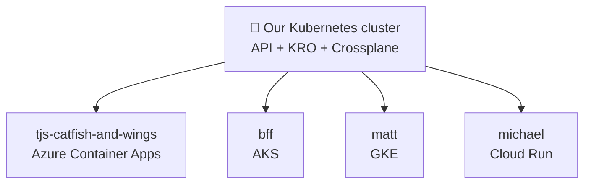
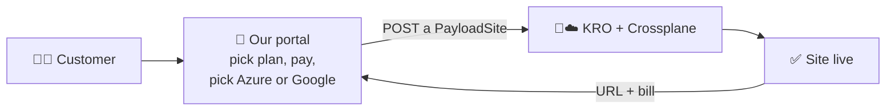

# 8. Example: Payload CMS sites as a product

This chapter puts everything together into one real product: **a Payload
CMS website for a customer, ordered with one request, running on whichever
cloud they choose.** The customer never sees Kubernetes; our platform does
all the work.

## The order form: a PayloadSite route

With KRO ([chapter 3](extending.md)) we add our own route to the API,
`payloadsites`. One record is one customer's Payload CMS site, and it reads
like a short form:

```yaml
apiVersion: kro.run/v1alpha1
kind: PayloadSite
metadata:
  name: main-site
  namespace: tjs-catfish-and-wings  # the tenant's folder
spec:
  domain: tjscatfishandwings.com
  target: azure-container-apps      # aks | azure-container-apps | gke | cloud-run
  size: small                       # small | medium | large
```

Creating it is one request:
`POST /apis/kro.run/v1alpha1/namespaces/tjs-catfish-and-wings/payloadsites`.
(`kro.run` is KRO's default group; it can carry our company's name instead.)

## What one POST builds

Payload CMS needs somewhere to run, a database, and a place for uploaded
media. The same form builds all three, on the cloud the customer picked:

| | AKS | Azure Container Apps | GKE | Cloud Run |
| --- | --- | --- | --- | --- |
| **Payload runs on** | Azure Kubernetes Service | Azure Container Apps | Google Kubernetes Engine | Google Cloud Run |
| **Database** | Azure Database for PostgreSQL | Azure Database for PostgreSQL | Cloud SQL | Cloud SQL |
| **Media files** | Azure Blob Storage | Azure Blob Storage | Cloud Storage | Cloud Storage |
| **Address + HTTPS** | Cloudflare | Cloudflare | Cloudflare | Cloudflare |

When everything is ready, the record fills in its status:
`url: https://tjscatfishandwings.com, ready: true`.



Our cluster is the brain; each customer's site runs wherever makes sense
for them. Mixed, multi-tenant, multi-cloud, all through one API.

## How it is built

Behind the route sits a short recipe, in plain words:

- **Every site** gets a database (Azure Postgres or Google Cloud SQL),
  a place for media files (Azure Blob Storage or Google Cloud Storage), and
  a Cloudflare address for its domain.
- **Where the site itself runs** depends on the target: on AKS or GKE it is
  an ordinary Kubernetes app with a front door; on Azure Container Apps or
  Cloud Run, Crossplane creates that cloud service directly.
- **When it is ready**, the record's status shows the site's address.

**KRO** writes that recipe down as a *Resource Graph Definition*: a
settings file listing the pieces and when each one applies (`includeWhen`).
KRO reads it, adds the `payloadsites` route on the spot, and creates the
pieces in the right order. **Crossplane** does the cloud part: every Azure
or Google resource in the recipe is itself a Kubernetes record that
Crossplane turns into the real thing, and keeps in line.

Other ways to build the same route:

- **Crossplane alone**, with a Composition (one PayloadSite in, the cloud
  pieces out).
- **Terraform / OpenTofu**, with the Flux OpenTofu controller running one
  module per target.

Whichever engine we use, the customer still just POSTs a PayloadSite, so
we can switch engines later without changing the route.

## Tenants: permissions and limits

Each customer gets a **namespace** (their folder), and two kinds of records
keep them safe and fair:

- **RBAC** (role-based access control) says who may use which routes,
  where. TJ's staff can see and edit sites only in
  `tjs-catfish-and-wings`; Matt can run VMs and workflows only in `matt`;
  our portal can create sites in every tenant folder; `dev-team` can do
  everything.
- **ResourceQuota** sets limits per folder, for example:

| Tenant | Payload sites | CPU |
| --- | --- | --- |
| `tjs-catfish-and-wings` | 2 | 4 |
| `bff` | 2 | 4 |
| `matt` | 0 | 8 |
| `michael` | 1 | 2 |

For TJ's, a third POST is refused with *403 Forbidden: exceeded quota*. On top of
that, Cilium network rules keep tenants from seeing each other's traffic.

## A customer portal on top

The customer-facing part is our own small app with a friendly screen:



Behind the "Create my site" button the portal does exactly one thing: POST
a PayloadSite. For billing it **watches** the route
(`GET /apis/kro.run/v1alpha1/payloadsites?watch=true`): a site created
starts billing, a size change changes the price, a site deleted stops
billing. That makes the portal an operator too.

The customer buys a website. Kubernetes is invisible to them.

## Why programs inside Kubernetes are cheap to build

Our portal runs inside the cluster, so it gets, for free:

| It needs | Kubernetes gives it | The Windows way |
| --- | --- | --- |
| Somewhere to keep state, and news of changes | The built-in database (etcd) and **watch** | Set up and run a SQL Server |
| To find other services | **CoreDNS**: call `billing.payments` by name | Hard-coded IPs or hosts files |
| An identity with just enough rights | A **ServiceAccount** with RBAC | A shared admin account |
| A public HTTPS address | One **HTTPRoute** record | IIS bindings and a firewall ticket |

Our whole portal is one Deployment, one identity and one HTTPRoute. The
platform supplies the rest.

[Plain-language dictionary :material-arrow-right:](dictionary.md){ .md-button .md-button--primary }
