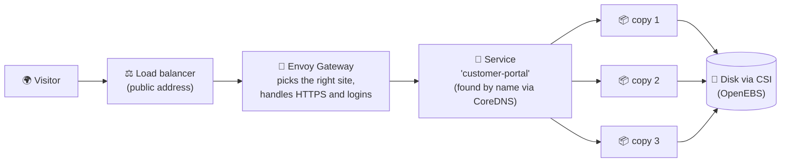
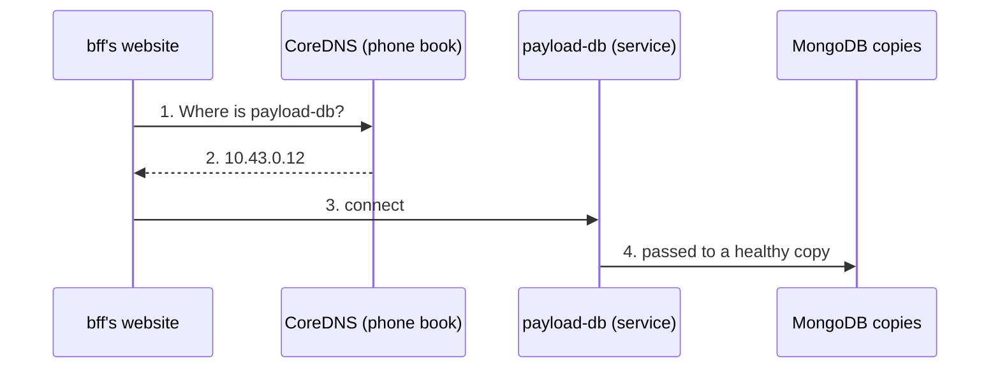

# 5. The plumbing comes free

Running a website for real takes far more than the website. It needs
names, networks, a front door from the internet, disks, security,
monitoring and a plan for when things break. On Windows Server, each of
those is a separate product, a separate project and often a separate team.

In Kubernetes, the plumbing is **part of the platform**. Each piece is just
another kind of record in the same API, so a new application gets all of it
on day one.

## The Windows world next to the Kubernetes world

| The job | Windows Server world | Kubernetes world |
| --- | --- | --- |
| Find other services by name | Windows DNS Server, edited by hand | **CoreDNS**: every service gets a name automatically |
| Connect the servers together | VLANs, firewall rules, a network team ticket | A **network plugin** (we use **Cilium**) connects every app to every other, with rules per app |
| Encrypt traffic between apps | Certificates installed server by server | A **mesh network** encrypts and controls app-to-app traffic for us |
| Let the internet in | IIS bindings, ARR reverse proxy, an F5 load balancer | **Gateway API** (the modern way) or **Ingress** (the older way), plus **LoadBalancer** services |
| Disks for data | A SAN, iSCSI, drive letters per server | **CSI** storage drivers: ask for "20 GB", get a disk that follows the app |
| Restart what crashed | A person, or a monitoring script | Built in: health checks restart and replace |
| Update with no downtime | Take a server out of the farm, update, put it back, repeat | Built in: **rolling updates**, one copy at a time; a broken version stops the rollout and is easy to roll back |
| Handle more visitors | Order and build another server | Built in: **autoscaling** adds copies (and, in the cloud, servers) |
| Passwords and certificates | web.config files, Credential Manager | **Secrets**, with permissions and audit |

## How a visitor reaches our site

Every box in that picture is a record in the Kubernetes API. If copy 2's
server dies, the Service stops sending visitors there, the controller starts
copy 4 elsewhere, and the disk follows it. Nobody touched anything.

## DNS: how programs find each other

Every cluster has its own DNS server, **CoreDNS**: a phone book for
everything inside the cluster that keeps itself up to date.

**A name says where it lives.** The full name of TJ's database is
`payload-db.tjs-catfish-and-wings.svc.cluster.local`: the service, the
tenant's folder, "it's a service", and "this cluster". Inside its own
folder, an app only needs the short name `payload-db`. So TJ's site and
bff's site run with **identical settings** and each still reaches its own
database (Postgres for TJ's, MongoDB for bff): the folder decides. Adding a tenant needs no reconfiguring.

**Things move, names don't.** Copies of apps move between servers all the
time (a server is patched, a server dies). The name stays; only the address
behind it changes, and CoreDNS updates in seconds. No hosts files, no
hard-coded IP addresses, no DNS tickets.

**Two phone books.** From the internet, **GoDaddy's** public DNS (where
Dad's domains live) turns `tjscatfishandwings.com` into our front door. Envoy Gateway then reads an
HTTPRoute record ("this domain goes to the `payload` service in TJ's
folder"), and CoreDNS finds that service.

**ExternalDNS keeps GoDaddy up to date.** ExternalDNS is a small
Kubernetes program (from the Kubernetes project) that watches our HTTPRoute
records. When a developer or our portal adds a site, it writes the matching
DNS record into GoDaddy through GoDaddy's API; change or delete the route
and the GoDaddy record follows. Nobody logs into GoDaddy to edit DNS by
hand.

## The front door: Envoy Gateway

Traffic between the internet and our apps is called **north-south**
traffic; traffic between apps inside the cluster is **east-west**
(handled by CoreDNS names and Cilium rules). **Envoy Gateway only handles
north-south**: it is the front door, and nothing else.

For a developer, publishing an app is **one record**, an HTTPRoute: "this
address goes to my app". No firewall ticket, no IIS bindings, no
certificate juggling.

Every request then passes a chain of Envoy **filters** before it reaches
the app:

1. **HTTPS**: certificates handled at the door.
2. **Sign-in (OIDC)**: a visitor who is not signed in is sent to a login
   provider we choose: **Keycloak** (our own), **Google**, or **AWS Cognito**.
   The provider vouches for who they are, and Envoy checks that on every
   request after that. Envoy can also ask an **external auth** service
   whether this person may use this app.
3. **Rate limits**: nobody can flood the app.
4. **Routing**: on to the right app, in the right folder.

The app only ever sees a request from a signed-in user. Sites **never
implement login in code**: the proxy offloads auth entirely, with no
HTTPS setup either. Every app gets the same protection, like IIS
authentication modules in front of every site at once, set up with records
instead of server settings.

## Runs anywhere: cloud and our own servers

Because the plumbing is defined by the Kubernetes API, and not by one
vendor's products, the same application runs the same way in many places:

-   :material-microsoft-azure: **Microsoft Azure** (AKS)
-   :material-aws: **Amazon Web Services** (EKS)
-   :material-google-cloud: **Google Cloud** (GKE)
-   :material-server: **Our own hardware**, in any building

Each cloud provider has **first-class support**: their load balancers, disks
and networks plug into Kubernetes automatically. On our own servers,
on-premises support is just as first-class: we bring our own load balancing
(Cilium with BGP) and storage (OpenEBS) and the applications cannot tell
the difference.

!!! example "Why a project manager should care"
    The question "*which cloud should we pick?*" stops being a decision we
    are locked into for ten years. Moving between clouds, or between a cloud
    and our own racks, becomes a migration of records, not a rewrite of the
    system.

!!! info "Windows is welcome too"
    Kubernetes can run **Windows Server containers** (Azure's AKS supports
    Windows nodes), and with **KubeVirt** ([chapter 4](extending.md)) it can
    run full **Windows Server virtual machines** next to everything else.
    Older Windows-only systems can join the platform before they are ever
    modernized.

[Next: Community and ownership :material-arrow-right:](community.md){ .md-button .md-button--primary }
