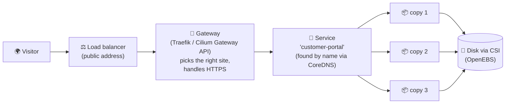

# 5. The plumbing comes free

Running a website for real takes far more than the website. It needs
names, networks, a front door from the internet, disks, security,
monitoring and a plan for when things break. On Windows Server, each of
those is a separate product, a separate project and often a separate team.

In Kubernetes, the plumbing is **part of the platform**. Each piece is just
another kind of record in the same API, so a new application gets all of it
on day one.

## The Windows world next to the Kubernetes world

| The job | Windows Server world | Kubernetes world |
| --- | --- | --- |
| Find other services by name | Windows DNS Server, edited by hand | **CoreDNS**: every service gets a name automatically |
| Connect the servers together | VLANs, firewall rules, a network team ticket | A **network plugin** (we use **Cilium**) connects every app to every other, with rules per app |
| Encrypt traffic between apps | Certificates installed server by server | A **mesh network** encrypts and controls app-to-app traffic for us |
| Let the internet in | IIS bindings, ARR reverse proxy, an F5 load balancer | **Gateway API** (the modern way) or **Ingress** (the older way), plus **LoadBalancer** services |
| Disks for data | A SAN, iSCSI, drive letters per server | **CSI** storage drivers: ask for "20 GB", get a disk that follows the app |
| Restart what crashed | A person, or a monitoring script | Built in: health checks restart and replace |
| Update with no downtime | Take a server out of the farm, update, put it back, repeat | Built in: **rolling updates**, one copy at a time; a broken version stops the rollout and is easy to roll back |
| Handle more visitors | Order and build another server | Built in: **autoscaling** adds copies (and, in the cloud, servers) |
| Passwords and certificates | web.config files, Credential Manager | **Secrets**, with permissions and audit |

## How a visitor reaches our site

Every box in that picture is a record in the Kubernetes API. If copy 2's
server dies, the Service stops sending visitors there, the controller starts
copy 4 elsewhere, and the disk follows it. Nobody touched anything.

## Runs anywhere: cloud and our own servers

Because the plumbing is defined by the Kubernetes API, and not by one
vendor's products, the same application runs the same way in many places:

-   :material-microsoft-azure: **Microsoft Azure** (AKS)
-   :material-aws: **Amazon Web Services** (EKS)
-   :material-google-cloud: **Google Cloud** (GKE)
-   :material-server: **Our own hardware**, in any building

Each cloud provider has **first-class support**: their load balancers, disks
and networks plug into Kubernetes automatically. On our own servers,
on-premises support is just as first-class: we bring our own load balancing
(Cilium with BGP) and storage (OpenEBS) and the applications cannot tell
the difference.

!!! example "Why a project manager should care"
    The question "*which cloud should we pick?*" stops being a decision we
    are locked into for ten years. Moving between clouds, or between a cloud
    and our own racks, becomes a migration of records, not a rewrite of the
    system.

!!! info "Windows is welcome too"
    Kubernetes can run **Windows Server containers** (Azure's AKS supports
    Windows nodes), and with **KubeVirt** ([chapter 3](extending.md)) it can
    run full **Windows Server virtual machines** next to everything else.
    Older Windows-only systems can join the platform before they are ever
    modernized.

[Next: Community and ownership :material-arrow-right:](community.md){ .md-button .md-button--primary }
