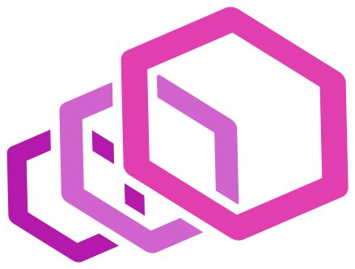
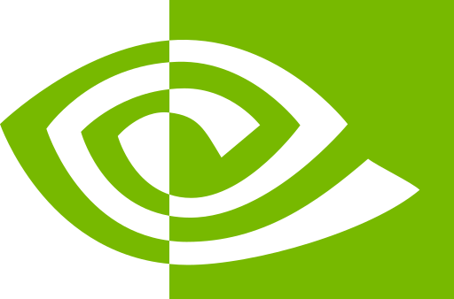
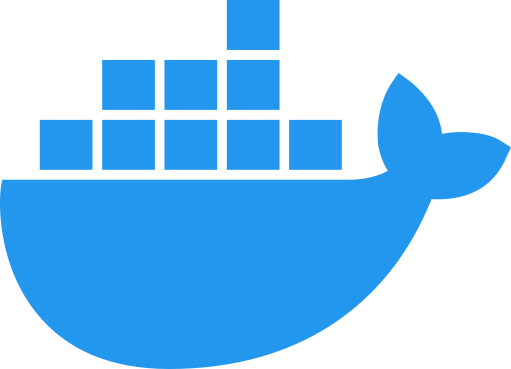
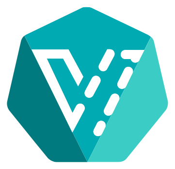
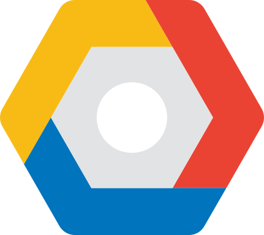
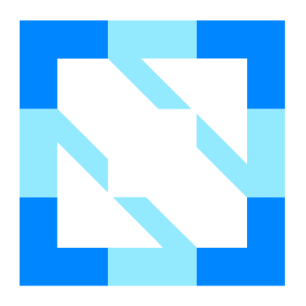

<!-- .slide: data-background-gradient="radial-gradient(circle at 70% 30%, #3a2a22, #141413 70%)" data-transition="zoom" class="title-slide" -->

For Dad

# Kubernetes

<h2>The Extensible API</h2>

a platform that develops itself

→ next topic · ↓ deeper · F full screen · Esc overview

Note:
Eight topics, left to right. Press the down arrow on any of them for more.
Tonight's one idea: Kubernetes is an API that manages resources, any
resource, and we can keep teaching it new ones.

---

<!-- .slide: data-background-gradient="radial-gradient(circle at 50% 70%, #3a3226, #1f1e1d 70%)" -->

What is Kubernetes?

## First, a reliable database

<svg class="sketch" viewBox="0 0 1200 470" style="max-height:430px" xmlns="http://www.w3.org/2000/svg">
<rect x="450" y="170" width="300" height="240" rx="14" stroke="#e3c08d" stroke-width="2" fill="#2b2a27" data-fill="solid"/>
<ellipse cx="600" cy="170" rx="150" ry="26" stroke="#e3c08d" stroke-width="2" fill="#e3c08d"/>
<image href="icons/etcd.svg" x="570" y="205" width="60" height="60"/>
<text x="600" y="300" font-size="28" fill="#faf9f5" text-anchor="middle">the datastore</text>
<text x="600" y="328" font-size="19" fill="#b0aea5" text-anchor="middle" class="sans">etcd, in our clusters</text>
<g class="fragment fade-in" data-fragment-index="1">
<image href="icons/postgresql.svg" x="538" y="355" width="34" height="34"/>
<image href="icons/cncf-nats.svg" x="628" y="355" width="34" height="34"/>
<text x="600" y="400" font-size="17" fill="#b0aea5" text-anchor="middle" class="sans">or PostgreSQL, or NATS</text>
</g>
<g class="fragment fade-in" data-fragment-index="2">
<rect x="370" y="30" width="460" height="420" rx="14" stroke="#d97757" stroke-width="3" fill="none"/>
<image href="icons/kubernetes.svg" x="392" y="52" width="46" height="46"/>
<text x="625" y="85" font-size="28" fill="#d97757" text-anchor="middle" font-weight="700">the Kubernetes API</text>
<text x="600" y="125" font-size="18" fill="#faf9f5" text-anchor="middle" class="sans">logins · permissions · checks · history · watch</text>
</g>
<g class="fragment fade-in" data-fragment-index="3">
<image href="icons/lucide-user.svg" x="113" y="83" width="54" height="54"/>
<text x="140" y="168" font-size="24" fill="#faf9f5" text-anchor="middle">you</text>
<line x1="190" y1="110" x2="360" y2="140" stroke="#faf9f5" stroke-width="2" fill="none" data-arrow/>
</g>
<g class="fragment fade-in" data-fragment-index="3">
<image href="icons/lucide-layout-dashboard.svg" x="113" y="273" width="54" height="54"/>
<text x="140" y="358" font-size="24" fill="#faf9f5" text-anchor="middle">dashboards</text>
<line x1="190" y1="300" x2="360" y2="330" stroke="#faf9f5" stroke-width="2" fill="none" data-arrow/>
</g>
<g class="fragment fade-in" data-fragment-index="3">
<image href="icons/lucide-refresh-cw.svg" x="1033" y="83" width="54" height="54"/>
<text x="1060" y="168" font-size="24" fill="#faf9f5" text-anchor="middle">controllers</text>
<line x1="1010" y1="110" x2="840" y2="140" stroke="#faf9f5" stroke-width="2" fill="none" data-arrow/>
</g>
<g class="fragment fade-in" data-fragment-index="3">
<image href="icons/payload-light.svg" x="1033" y="273" width="54" height="54"/>
<text x="1060" y="358" font-size="24" fill="#faf9f5" text-anchor="middle">our portal</text>
<line x1="1010" y1="300" x2="840" y2="330" stroke="#faf9f5" stroke-width="2" fill="none" data-arrow/>
</g>
</svg>

Kubernetes = <strong>a reliable datastore, wrapped in an API</strong> we can extend.

↓ why it's reliable · what the API adds

Note:
Start at the bottom. Everything Kubernetes knows is a record in one
datastore: every app, VM, website, tenant and setting. We use etcd; it
can also be PostgreSQL or NATS. Nobody talks to that database directly:
the Kubernetes API wraps it, and you, dashboards, our portal and the
controllers all go through the API.

--

<!-- .slide: data-transition="fade" -->

## Why the datastore is reliable

<svg class="sketch" viewBox="0 0 1200 400" style="max-height:400px" xmlns="http://www.w3.org/2000/svg">
<text x="600" y="40" font-size="24" fill="#d97757" text-anchor="middle">write: "TJ's new site"</text>
<line x1="600" y1="55" x2="600" y2="110" stroke="#d97757" stroke-width="2" fill="none" data-arrow/>
<image href="icons/etcd.svg" x="228" y="118" width="44" height="44"/>
<image href="icons/lucide-server.svg" x="218" y="178" width="64" height="64"/>
<text x="250" y="275" font-size="20" fill="#b0aea5" text-anchor="middle" class="sans">a copy</text>
<image href="icons/etcd.svg" x="578" y="118" width="44" height="44"/>
<image href="icons/lucide-server.svg" x="568" y="178" width="64" height="64"/>
<text x="600" y="275" font-size="20" fill="#b0aea5" text-anchor="middle" class="sans">a copy</text>
<image href="icons/etcd.svg" x="928" y="118" width="44" height="44"/>
<image href="icons/lucide-server.svg" x="918" y="178" width="64" height="64"/>
<text x="950" y="275" font-size="20" fill="#b0aea5" text-anchor="middle" class="sans">a copy</text>
<line x1="300" y1="210" x2="545" y2="210" stroke="#faf9f5" stroke-width="2" fill="none" data-dash/>
<line x1="655" y1="210" x2="900" y2="210" stroke="#faf9f5" stroke-width="2" fill="none" data-dash/>
<g class="fragment fade-in" data-fragment-index="1">
<text x="600" y="330" font-size="26" fill="#e3c08d" text-anchor="middle">saved once most copies agree</text>
</g>
<g class="fragment fade-in" data-fragment-index="2">
<line x1="915" y1="175" x2="985" y2="245" stroke="#c9789a" stroke-width="4" fill="none"/>
<line x1="985" y1="175" x2="915" y2="245" stroke="#c9789a" stroke-width="4" fill="none"/>
<text x="950" y="300" font-size="22" fill="#c9789a" text-anchor="middle" class="sans">a server dies</text>
</g>
<g class="fragment fade-in" data-fragment-index="3">
<text x="600" y="375" font-size="26" fill="#8fa876" text-anchor="middle">the other two carry on: nothing lost, nothing down</text>
</g>
</svg>

Note:
etcd keeps every record on three (or five) servers. A change only counts
once most of them have it. One server can die, or be patched, and nothing
is lost or stops. Like a SQL Server Always On availability group, built
in and free.

--

<!-- .slide: data-transition="fade" -->

## The API wraps the database

<svg class="sketch" viewBox="0 0 1200 230" xmlns="http://www.w3.org/2000/svg">
<image href="icons/lucide-user.svg" x="44" y="94" width="52" height="52"/>
<text x="70" y="176" font-size="26" fill="#faf9f5" text-anchor="middle">a request</text>
<rect x="150" y="40" width="840" height="170" rx="14" stroke="#d97757" stroke-width="2" fill="#d97757"/>
<text x="170" y="72" font-size="22" fill="#faf9f5" text-anchor="start">the API, around the datastore</text>
<line x1="105" y1="120" x2="170" y2="130" stroke="#faf9f5" stroke-width="2" fill="none" data-arrow/>
<g class="fragment fade-in" data-fragment-index="1">
<rect x="170" y="90" width="150" height="100" rx="14" stroke="#faf9f5" stroke-width="2" fill="#2b2a27" data-fill="solid"/>
<image href="icons/lucide-user-check.svg" x="228" y="108" width="34" height="34"/>
<text x="245" y="175" font-size="19" fill="#faf9f5" text-anchor="middle" class="sans">who are you?</text>
<line x1="320" y1="140" x2="332" y2="140" stroke="#faf9f5" stroke-width="2" fill="none"/>
</g>
<g class="fragment fade-in" data-fragment-index="2">
<rect x="332" y="90" width="150" height="100" rx="14" stroke="#faf9f5" stroke-width="2" fill="#2b2a27" data-fill="solid"/>
<image href="icons/lucide-key-round.svg" x="390" y="108" width="34" height="34"/>
<text x="407" y="175" font-size="19" fill="#faf9f5" text-anchor="middle" class="sans">allowed?</text>
<line x1="482" y1="140" x2="494" y2="140" stroke="#faf9f5" stroke-width="2" fill="none"/>
</g>
<g class="fragment fade-in" data-fragment-index="3">
<rect x="494" y="90" width="150" height="100" rx="14" stroke="#faf9f5" stroke-width="2" fill="#2b2a27" data-fill="solid"/>
<image href="icons/lucide-search-check.svg" x="552" y="108" width="34" height="34"/>
<text x="569" y="175" font-size="19" fill="#faf9f5" text-anchor="middle" class="sans">a valid record?</text>
<line x1="644" y1="140" x2="656" y2="140" stroke="#faf9f5" stroke-width="2" fill="none"/>
</g>
<g class="fragment fade-in" data-fragment-index="4">
<rect x="656" y="90" width="150" height="100" rx="14" stroke="#faf9f5" stroke-width="2" fill="#2b2a27" data-fill="solid"/>
<image href="icons/lucide-file-text.svg" x="714" y="108" width="34" height="34"/>
<text x="731" y="175" font-size="19" fill="#faf9f5" text-anchor="middle" class="sans">keep history</text>
<line x1="806" y1="140" x2="818" y2="140" stroke="#faf9f5" stroke-width="2" fill="none"/>
</g>
<g class="fragment fade-in" data-fragment-index="5">
<rect x="818" y="90" width="150" height="100" rx="14" stroke="#faf9f5" stroke-width="2" fill="#2b2a27" data-fill="solid"/>
<image href="icons/lucide-eye.svg" x="876" y="108" width="34" height="34"/>
<text x="893" y="175" font-size="19" fill="#faf9f5" text-anchor="middle" class="sans">tell watchers</text>
</g>
<g class="fragment fade-in" data-fragment-index="6">
<line x1="990" y1="140" x2="1060" y2="140" stroke="#faf9f5" stroke-width="2" fill="none" data-arrow/>
<image href="icons/etcd.svg" x="1084" y="99" width="52" height="52"/>
<text x="1110" y="185" font-size="22" fill="#faf9f5" text-anchor="middle">datastore</text>
</g>
</svg>

GET POST PUT DELETE &nbsp;= SELECT, INSERT, UPDATE, DELETE

Every read and write passes these checks. So anything we store in it gets logins, permissions, history and live updates <strong>for free</strong>.

Note:
This is why it matters that the database is wrapped: when we add a new
kind of record later, a PayloadSite or a VM, it gets all of these checks
without us writing any of them.

---

What the API manages

## Any resource, not just containers

<svg class="sketch" viewBox="0 0 1200 690" style="max-height:430px" xmlns="http://www.w3.org/2000/svg">
<ellipse cx="600" cy="320" rx="150" ry="62" stroke="#d97757" stroke-width="3" fill="#d97757"/>
<image href="icons/kubernetes.svg" x="477" y="289" width="62" height="62"/>
<text x="630" y="316" font-size="30" fill="#faf9f5" text-anchor="middle" font-weight="700">Kubernetes</text>
<text x="630" y="348" font-size="26" fill="#faf9f5" text-anchor="middle">API</text>
<text x="600" y="420" font-size="18" fill="#b0aea5" text-anchor="middle" class="sans">time goes clockwise ↻</text>
<text x="738" y="37" font-size="20" fill="#d97757" text-anchor="middle" font-weight="700">2015</text>
<image href="icons/lucide-box.svg" x="711" y="48" width="54" height="54"/>
<text x="738" y="132" font-size="24" fill="#e3c08d" text-anchor="middle">Containers</text>
<text x="738" y="158" font-size="19" fill="#b0aea5" text-anchor="middle" class="sans">version 1</text>
<g class="fragment fade-in">
<polyline points="794,86 800,87 806,89 813,90 819,92 824,93 830,95 836,97 842,98 848,100 854,102 859,104 865,105 871,107 876,109 882,111 887,113 892,115 898,117 903,120 908,122 913,124 918,126 923,128 928,131" stroke="#d97757" stroke-width="3" fill="none" data-arrow/>
<text x="902" y="160" font-size="20" fill="#d97757" text-anchor="middle" font-weight="700">2016</text>
<image href="icons/dotnet.svg" x="943" y="126" width="54" height="54"/>
<text x="970" y="210" font-size="24" fill="#faf9f5" text-anchor="middle">.NET apps</text>
<text x="970" y="236" font-size="19" fill="#b0aea5" text-anchor="middle" class="sans">with their data</text>
</g>
<g class="fragment fade-in">
<polyline points="1007,178 1010,181 1014,184 1017,187 1021,189 1024,192 1028,195 1031,199 1034,202 1037,205 1040,208 1043,211 1046,214 1048,217 1051,220 1054,224 1056,227 1059,230 1061,233 1063,237 1065,240 1067,243 1069,247 1071,250 1073,253" stroke="#d97757" stroke-width="3" fill="none" data-arrow/>
<text x="1017" y="291" font-size="20" fill="#d97757" text-anchor="middle" font-weight="700">2019</text>
<image href="icons/microsoft-windows.svg" x="1058" y="257" width="54" height="54"/>
<text x="1085" y="341" font-size="24" fill="#faf9f5" text-anchor="middle">Windows VMs</text>
<text x="1085" y="367" font-size="19" fill="#b0aea5" text-anchor="middle" class="sans">KubeVirt</text>
</g>
<g class="fragment fade-in">
<polyline points="1090,315 1090,318 1090,322 1090,325 1090,329 1089,332 1089,336 1089,339 1088,342 1087,346 1087,349 1086,353 1085,356 1084,360 1083,363 1082,367 1080,370 1079,373 1078,377 1076,380 1075,384 1073,387 1071,390 1069,394 1067,397" stroke="#d97757" stroke-width="3" fill="none" data-arrow/>
<text x="978" y="433" font-size="20" fill="#d97757" text-anchor="middle" font-weight="700">2020</text>
<image href="icons/microsoft-azure.svg" x="1019" y="399" width="54" height="54"/>
<text x="1046" y="483" font-size="24" fill="#faf9f5" text-anchor="middle">Cloud infrastructure</text>
<text x="1046" y="509" font-size="19" fill="#b0aea5" text-anchor="middle" class="sans">Crossplane</text>
</g>
<g class="fragment fade-in">
<polyline points="1018,453 1014,456 1010,459 1007,462 1003,465 999,468 995,471 991,473 987,476 983,479 979,482 975,484 970,487 966,490 961,492 957,495 952,497 948,500 943,502 938,505 933,507 928,509 923,512 918,514 913,516" stroke="#d97757" stroke-width="3" fill="none" data-arrow/>
<text x="865" y="497" font-size="20" fill="#d97757" text-anchor="middle" font-weight="700">2020</text>
<image href="icons/cncf-argo.svg" x="838" y="508" width="54" height="54"/>
<text x="865" y="592" font-size="24" fill="#faf9f5" text-anchor="middle">Workflows</text>
<text x="865" y="618" font-size="19" fill="#b0aea5" text-anchor="middle" class="sans">Argo</text>
</g>
<g class="fragment fade-in">
<polyline points="813,550 807,551 801,553 794,554 788,555 782,557 776,558 770,559 763,560 757,562 751,563 744,564 738,565 732,566 725,567 719,567 712,568 706,569 699,570 693,570 686,571 680,572 673,572 666,573 660,573" stroke="#d97757" stroke-width="3" fill="none" data-arrow/>
<text x="600" y="537" font-size="20" fill="#d97757" text-anchor="middle" font-weight="700">2022</text>
<image href="icons/postgresql.svg" x="573" y="548" width="54" height="54"/>
<text x="600" y="632" font-size="24" fill="#faf9f5" text-anchor="middle">Databases</text>
<text x="600" y="658" font-size="19" fill="#b0aea5" text-anchor="middle" class="sans">CloudNativePG</text>
</g>
<g class="fragment fade-in">
<polyline points="540,573 534,573 527,572 520,572 514,571 507,570 501,570 494,569 488,568 481,567 475,567 468,566 462,565 456,564 449,563 443,562 437,560 430,559 424,558 418,557 412,555 406,554 399,553 393,551 387,550" stroke="#d97757" stroke-width="3" fill="none" data-arrow/>
<text x="335" y="497" font-size="20" fill="#d97757" text-anchor="middle" font-weight="700">2023</text>
<image href="icons/envoy-gateway.svg" x="308" y="508" width="54" height="54"/>
<text x="335" y="592" font-size="24" fill="#faf9f5" text-anchor="middle">Proxy settings</text>
<text x="335" y="618" font-size="19" fill="#b0aea5" text-anchor="middle" class="sans">Envoy Gateway</text>
</g>
<g class="fragment fade-in">
<polyline points="287,516 282,514 277,512 272,509 267,507 262,505 257,502 252,500 248,497 243,495 239,492 234,490 230,487 225,484 221,482 217,479 213,476 209,473 205,471 201,468 197,465 193,462 190,459 186,456 182,453" stroke="#d97757" stroke-width="3" fill="none" data-arrow/>
<text x="222" y="433" font-size="20" fill="#d97757" text-anchor="middle" font-weight="700">2025</text>
<image href="icons/payload-light.svg" x="127" y="399" width="54" height="54"/>
<text x="154" y="483" font-size="24" fill="#faf9f5" text-anchor="middle">Payload CMS sites</text>
<text x="154" y="509" font-size="19" fill="#b0aea5" text-anchor="middle" class="sans">NetSam, with KRO</text>
</g>
<g class="fragment fade-in">
<polyline points="133,397 131,394 129,390 127,387 125,384 124,380 122,377 121,373 120,370 118,367 117,363 116,360 115,356 114,353 113,349 113,346 112,342 111,339 111,336 111,332 110,329 110,325 110,322 110,318 110,315" stroke="#d97757" stroke-width="3" fill="none" data-arrow/>
<text x="183" y="291" font-size="20" fill="#d97757" text-anchor="middle" font-weight="700">today</text>
<image href="icons/minecraft.svg" x="88" y="257" width="54" height="54"/>
<text x="115" y="341" font-size="24" fill="#faf9f5" text-anchor="middle">Minecraft servers</text>
<text x="115" y="367" font-size="19" fill="#b0aea5" text-anchor="middle" class="sans">NetSam's own CRD</text>
</g>
<g class="fragment fade-in">
<polyline points="127,253 129,250 131,247 133,243 135,240 137,237 139,233 141,230 144,227 146,224 149,220 152,217 154,214 157,211 160,208 163,205 166,202 169,199 172,195 176,192 179,189 183,187 186,184 190,181 193,178" stroke="#d97757" stroke-width="3" fill="none" data-arrow/>
<text x="298" y="160" font-size="20" fill="#d97757" text-anchor="middle" font-weight="700">today</text>
<image href="icons/lucide-paperclip.svg" x="203" y="126" width="54" height="54"/>
<text x="230" y="210" font-size="24" fill="#faf9f5" text-anchor="middle">Paperclip</text>
<text x="230" y="236" font-size="19" fill="#b0aea5" text-anchor="middle" class="sans">the Paperclip operator</text>
</g>
<g class="fragment fade-in">
<polyline points="272,131 277,128 282,126 287,124 292,122 297,120 302,117 308,115 313,113 318,111 324,109 329,107 335,105 341,104 346,102 352,100 358,98 364,97 370,95 376,93 381,92 387,90 394,89 400,87 406,86" stroke="#d97757" stroke-width="3" fill="none" data-arrow/>
<text x="462" y="37" font-size="20" fill="#d97757" text-anchor="middle" font-weight="700">today</text>
<image href="icons/nvidia.svg" x="435" y="48" width="54" height="54"/>
<text x="462" y="132" font-size="24" fill="#8fa876" text-anchor="middle">AI agents</text>
<text x="462" y="158" font-size="19" fill="#b0aea5" text-anchor="middle" class="sans">NVIDIA OpenShell</text>
</g>
</svg>

Version 1 ran only <em>stateless containers</em>. Today it runs <strong>AI agents</strong>.

↓ history · the new kinds · how it manages them

Note:
Read it like a clock. In 2015, Kubernetes did one thing: start
containers that keep no data, and restart them when they die. Going
clockwise, each stop is something it has since been taught to manage:
.NET apps that keep data, Windows Server VMs, Azure and Google resources,
workflows, Postgres databases, the proxy that is our front door, our
customers' Payload CMS sites, Minecraft servers, Paperclip and, today,
AI agents. Same API for all of it.

--

<!-- .slide: data-transition="fade" -->

## Kubernetes itself keeps improving

<svg class="sketch" viewBox="0 0 1200 430" style="max-height:470px" xmlns="http://www.w3.org/2000/svg">
<line x1="40" y1="230" x2="1180" y2="230" stroke="#b0aea5" stroke-width="3" fill="none" data-arrow/>
<g class="fragment fade-in">
<line x1="85" y1="230" x2="85" y2="175" stroke="#d97757" stroke-width="2" fill="none"/>
<circle cx="85" cy="230" r="7" stroke="#d97757" stroke-width="2" fill="#d97757" data-fill="solid"/>
<image href="icons/kubernetes.svg" x="65" y="50" width="40" height="40"/>
<text x="85" y="118" font-size="24" fill="#d97757" text-anchor="middle" font-weight="700">2014</text>
<text x="85" y="142" font-size="16" fill="#faf9f5" text-anchor="middle" class="sans">Google open-sources it</text>
<text x="85" y="161" font-size="16" fill="#b0aea5" text-anchor="middle" class="sans">after 10 years of Borg</text>
</g>
<g class="fragment fade-in">
<line x1="214" y1="230" x2="214" y2="285" stroke="#d97757" stroke-width="2" fill="none"/>
<circle cx="214" cy="230" r="7" stroke="#d97757" stroke-width="2" fill="#d97757" data-fill="solid"/>
<image href="icons/cncf.svg" x="194" y="300" width="40" height="40"/>
<text x="214" y="370" font-size="24" fill="#d97757" text-anchor="middle" font-weight="700">2015</text>
<text x="214" y="394" font-size="16" fill="#faf9f5" text-anchor="middle" class="sans">Version 1.0, given</text>
<text x="214" y="413" font-size="16" fill="#b0aea5" text-anchor="middle" class="sans">to the new CNCF</text>
</g>
<g class="fragment fade-in">
<line x1="343" y1="230" x2="343" y2="175" stroke="#d97757" stroke-width="2" fill="none"/>
<circle cx="343" cy="230" r="7" stroke="#d97757" stroke-width="2" fill="#d97757" data-fill="solid"/>
<image href="icons/lucide-file-text.svg" x="323" y="50" width="40" height="40"/>
<text x="343" y="118" font-size="24" fill="#d97757" text-anchor="middle" font-weight="700">2017</text>
<text x="343" y="142" font-size="16" fill="#faf9f5" text-anchor="middle" class="sans">Custom kinds (CRDs)</text>
<text x="343" y="161" font-size="16" fill="#b0aea5" text-anchor="middle" class="sans">+ permissions (RBAC)</text>
</g>
<g class="fragment fade-in">
<line x1="472" y1="230" x2="472" y2="285" stroke="#d97757" stroke-width="2" fill="none"/>
<circle cx="472" cy="230" r="7" stroke="#d97757" stroke-width="2" fill="#d97757" data-fill="solid"/>
<image href="icons/coredns.svg" x="452" y="300" width="40" height="40"/>
<text x="472" y="370" font-size="24" fill="#d97757" text-anchor="middle" font-weight="700">2018</text>
<text x="472" y="394" font-size="16" fill="#faf9f5" text-anchor="middle" class="sans">CoreDNS becomes its DNS;</text>
<text x="472" y="413" font-size="16" fill="#b0aea5" text-anchor="middle" class="sans">CSI: the storage plug</text>
</g>
<g class="fragment fade-in">
<line x1="601" y1="230" x2="601" y2="175" stroke="#d97757" stroke-width="2" fill="none"/>
<circle cx="601" cy="230" r="7" stroke="#d97757" stroke-width="2" fill="#d97757" data-fill="solid"/>
<image href="icons/microsoft-windows.svg" x="581" y="50" width="40" height="40"/>
<text x="601" y="118" font-size="24" fill="#d97757" text-anchor="middle" font-weight="700">2019</text>
<text x="601" y="142" font-size="16" fill="#faf9f5" text-anchor="middle" class="sans">Windows Server</text>
<text x="601" y="161" font-size="16" fill="#b0aea5" text-anchor="middle" class="sans">containers</text>
</g>
<g class="fragment fade-in">
<line x1="730" y1="230" x2="730" y2="285" stroke="#d97757" stroke-width="2" fill="none"/>
<circle cx="730" cy="230" r="7" stroke="#d97757" stroke-width="2" fill="#d97757" data-fill="solid"/>
<image href="icons/lucide-route.svg" x="710" y="300" width="40" height="40"/>
<text x="730" y="370" font-size="24" fill="#d97757" text-anchor="middle" font-weight="700">2020</text>
<text x="730" y="394" font-size="16" fill="#faf9f5" text-anchor="middle" class="sans">Ingress: the first</text>
<text x="730" y="413" font-size="16" fill="#b0aea5" text-anchor="middle" class="sans">front door</text>
</g>
<g class="fragment fade-in">
<line x1="859" y1="230" x2="859" y2="175" stroke="#d97757" stroke-width="2" fill="none"/>
<circle cx="859" cy="230" r="7" stroke="#d97757" stroke-width="2" fill="#d97757" data-fill="solid"/>
<image href="icons/envoy-gateway.svg" x="839" y="50" width="40" height="40"/>
<text x="859" y="118" font-size="24" fill="#d97757" text-anchor="middle" font-weight="700">2023</text>
<text x="859" y="142" font-size="16" fill="#faf9f5" text-anchor="middle" class="sans">Gateway API 1.0:</text>
<text x="859" y="161" font-size="16" fill="#b0aea5" text-anchor="middle" class="sans">the modern front door</text>
</g>
<g class="fragment fade-in">
<line x1="988" y1="230" x2="988" y2="285" stroke="#d97757" stroke-width="2" fill="none"/>
<circle cx="988" cy="230" r="7" stroke="#d97757" stroke-width="2" fill="#d97757" data-fill="solid"/>
<image href="icons/nvidia.svg" x="968" y="300" width="40" height="40"/>
<text x="988" y="370" font-size="24" fill="#d97757" text-anchor="middle" font-weight="700">2025</text>
<text x="988" y="394" font-size="16" fill="#faf9f5" text-anchor="middle" class="sans">GPUs as a resource;</text>
<text x="988" y="413" font-size="16" fill="#b0aea5" text-anchor="middle" class="sans">resize apps live</text>
</g>
<g class="fragment fade-in">
<line x1="1117" y1="230" x2="1117" y2="175" stroke="#d97757" stroke-width="2" fill="none"/>
<circle cx="1117" cy="230" r="7" stroke="#d97757" stroke-width="2" fill="#d97757" data-fill="solid"/>
<image href="icons/lucide-refresh-cw.svg" x="1097" y="50" width="40" height="40"/>
<text x="1117" y="118" font-size="24" fill="#d97757" text-anchor="middle" font-weight="700">today</text>
<text x="1117" y="142" font-size="16" fill="#faf9f5" text-anchor="middle" class="sans">a new release</text>
<text x="1117" y="161" font-size="16" fill="#b0aea5" text-anchor="middle" class="sans">every 4 months</text>
</g>
</svg>

Note:
Each of these was added to Kubernetes itself, and every cluster got it by
upgrading. 2017: custom kinds of record (CRDs), the thing this whole talk
is about. 2018: CoreDNS became the built-in phone book, and CSI made
storage a plug-in, so any disk vendor can plug in. 2019: Windows Server
containers. 2023: Gateway API, the modern front door Envoy Gateway uses.
2025: GPUs became a first-class resource, and apps can be resized without
restarting.

--

<!-- .slide: data-transition="fade" -->

## When the projects started, and joined the CNCF

<svg class="sketch" viewBox="0 0 1200 449" style="max-height:500px" xmlns="http://www.w3.org/2000/svg">
<line x1="260" y1="30" x2="260" y2="399" stroke="#363430" stroke-width="1" fill="none"/>
<text x="293" y="22" font-size="15" fill="#b0aea5" text-anchor="middle" class="sans">'13</text>
<line x1="324" y1="30" x2="324" y2="399" stroke="#363430" stroke-width="1" fill="none"/>
<text x="357" y="22" font-size="15" fill="#b0aea5" text-anchor="middle" class="sans">'14</text>
<line x1="388" y1="30" x2="388" y2="399" stroke="#363430" stroke-width="1" fill="none"/>
<text x="421" y="22" font-size="15" fill="#b0aea5" text-anchor="middle" class="sans">'15</text>
<line x1="452" y1="30" x2="452" y2="399" stroke="#363430" stroke-width="1" fill="none"/>
<text x="485" y="22" font-size="15" fill="#b0aea5" text-anchor="middle" class="sans">'16</text>
<line x1="516" y1="30" x2="516" y2="399" stroke="#363430" stroke-width="1" fill="none"/>
<text x="549" y="22" font-size="15" fill="#b0aea5" text-anchor="middle" class="sans">'17</text>
<line x1="580" y1="30" x2="580" y2="399" stroke="#363430" stroke-width="1" fill="none"/>
<text x="613" y="22" font-size="15" fill="#b0aea5" text-anchor="middle" class="sans">'18</text>
<line x1="644" y1="30" x2="644" y2="399" stroke="#363430" stroke-width="1" fill="none"/>
<text x="677" y="22" font-size="15" fill="#b0aea5" text-anchor="middle" class="sans">'19</text>
<line x1="708" y1="30" x2="708" y2="399" stroke="#363430" stroke-width="1" fill="none"/>
<text x="741" y="22" font-size="15" fill="#b0aea5" text-anchor="middle" class="sans">'20</text>
<line x1="772" y1="30" x2="772" y2="399" stroke="#363430" stroke-width="1" fill="none"/>
<text x="805" y="22" font-size="15" fill="#b0aea5" text-anchor="middle" class="sans">'21</text>
<line x1="836" y1="30" x2="836" y2="399" stroke="#363430" stroke-width="1" fill="none"/>
<text x="869" y="22" font-size="15" fill="#b0aea5" text-anchor="middle" class="sans">'22</text>
<line x1="900" y1="30" x2="900" y2="399" stroke="#363430" stroke-width="1" fill="none"/>
<text x="933" y="22" font-size="15" fill="#b0aea5" text-anchor="middle" class="sans">'23</text>
<line x1="964" y1="30" x2="964" y2="399" stroke="#363430" stroke-width="1" fill="none"/>
<text x="997" y="22" font-size="15" fill="#b0aea5" text-anchor="middle" class="sans">'24</text>
<line x1="1028" y1="30" x2="1028" y2="399" stroke="#363430" stroke-width="1" fill="none"/>
<text x="1061" y="22" font-size="15" fill="#b0aea5" text-anchor="middle" class="sans">'25</text>
<line x1="1092" y1="30" x2="1092" y2="399" stroke="#363430" stroke-width="1" fill="none"/>
<g class="fragment fade-in">
<image href="icons/kubernetes.svg" x="18" y="43" width="24" height="24"/>
<text x="52" y="62" font-size="19" fill="#faf9f5" text-anchor="start" class="sans">Kubernetes</text>
<circle cx="356.0" cy="55" r="6" stroke="#b0aea5" stroke-width="2" fill="none"/>
<line x1="362" y1="55" x2="465" y2="55" stroke="#b0aea5" stroke-width="2" fill="none" data-dash/>
<line x1="465" y1="55" x2="593" y2="55" stroke="#e3c08d" stroke-width="4" fill="none"/>
<line x1="593" y1="55" x2="1143" y2="55" stroke="#8fa876" stroke-width="5" fill="none"/>
<circle cx="592.8000000000029" cy="55" r="8" stroke="#8fa876" stroke-width="2" fill="#8fa876" data-fill="solid"/>
</g>
<g class="fragment fade-in">
<image href="icons/etcd.svg" x="18" y="76" width="24" height="24"/>
<text x="52" y="95" font-size="19" fill="#faf9f5" text-anchor="start" class="sans">etcd</text>
<circle cx="292.0" cy="88" r="6" stroke="#b0aea5" stroke-width="2" fill="none"/>
<line x1="298" y1="88" x2="641" y2="88" stroke="#b0aea5" stroke-width="2" fill="none" data-dash/>
<line x1="641" y1="88" x2="766" y2="88" stroke="#e3c08d" stroke-width="4" fill="none"/>
<line x1="766" y1="88" x2="1143" y2="88" stroke="#8fa876" stroke-width="5" fill="none"/>
<circle cx="765.6000000000058" cy="88" r="8" stroke="#8fa876" stroke-width="2" fill="#8fa876" data-fill="solid"/>
</g>
<g class="fragment fade-in">
<image href="icons/coredns.svg" x="18" y="109" width="24" height="24"/>
<text x="52" y="128" font-size="19" fill="#faf9f5" text-anchor="start" class="sans">CoreDNS</text>
<circle cx="464.8000000000029" cy="121" r="6" stroke="#b0aea5" stroke-width="2" fill="none"/>
<line x1="471" y1="121" x2="522" y2="121" stroke="#b0aea5" stroke-width="2" fill="none" data-dash/>
<line x1="522" y1="121" x2="647" y2="121" stroke="#e3c08d" stroke-width="4" fill="none"/>
<line x1="647" y1="121" x2="1143" y2="121" stroke="#8fa876" stroke-width="5" fill="none"/>
<circle cx="647.1999999999971" cy="121" r="8" stroke="#8fa876" stroke-width="2" fill="#8fa876" data-fill="solid"/>
</g>
<g class="fragment fade-in">
<image href="icons/envoy-gateway.svg" x="18" y="142" width="24" height="24"/>
<text x="52" y="161" font-size="19" fill="#faf9f5" text-anchor="start" class="sans">Envoy</text>
<circle cx="452.0" cy="154" r="6" stroke="#b0aea5" stroke-width="2" fill="none"/>
<line x1="458" y1="154" x2="561" y2="154" stroke="#b0aea5" stroke-width="2" fill="none" data-dash/>
<line x1="561" y1="154" x2="638" y2="154" stroke="#e3c08d" stroke-width="4" fill="none"/>
<line x1="638" y1="154" x2="1143" y2="154" stroke="#8fa876" stroke-width="5" fill="none"/>
<circle cx="637.6000000000058" cy="154" r="8" stroke="#8fa876" stroke-width="2" fill="#8fa876" data-fill="solid"/>
</g>
<g class="fragment fade-in">
<image href="icons/flux-cd.svg" x="18" y="175" width="24" height="24"/>
<text x="52" y="194" font-size="19" fill="#faf9f5" text-anchor="start" class="sans">Flux</text>
<circle cx="484.0" cy="187" r="6" stroke="#b0aea5" stroke-width="2" fill="none"/>
<line x1="490" y1="187" x2="679" y2="187" stroke="#b0aea5" stroke-width="2" fill="none" data-dash/>
<line x1="679" y1="187" x2="894" y2="187" stroke="#e3c08d" stroke-width="4" fill="none"/>
<line x1="894" y1="187" x2="1143" y2="187" stroke="#8fa876" stroke-width="5" fill="none"/>
<circle cx="893.6000000000058" cy="187" r="8" stroke="#8fa876" stroke-width="2" fill="#8fa876" data-fill="solid"/>
</g>
<g class="fragment fade-in">
<image href="icons/cncf-kubevirt.svg" x="18" y="208" width="24" height="24"/>
<text x="52" y="227" font-size="19" fill="#faf9f5" text-anchor="start" class="sans">KubeVirt</text>
<circle cx="516.0" cy="220" r="6" stroke="#b0aea5" stroke-width="2" fill="none"/>
<line x1="522" y1="220" x2="689" y2="220" stroke="#b0aea5" stroke-width="2" fill="none" data-dash/>
<line x1="689" y1="220" x2="1143" y2="220" stroke="#e3c08d" stroke-width="4" fill="none"/>
</g>
<g class="fragment fade-in">
<image href="icons/cncf-argo.svg" x="18" y="241" width="24" height="24"/>
<text x="52" y="260" font-size="19" fill="#faf9f5" text-anchor="start" class="sans">Argo</text>
<circle cx="548.0" cy="253" r="6" stroke="#b0aea5" stroke-width="2" fill="none"/>
<line x1="554" y1="253" x2="727" y2="253" stroke="#b0aea5" stroke-width="2" fill="none" data-dash/>
<line x1="727" y1="253" x2="897" y2="253" stroke="#e3c08d" stroke-width="4" fill="none"/>
<line x1="897" y1="253" x2="1143" y2="253" stroke="#8fa876" stroke-width="5" fill="none"/>
<circle cx="896.8000000000029" cy="253" r="8" stroke="#8fa876" stroke-width="2" fill="#8fa876" data-fill="solid"/>
</g>
<g class="fragment fade-in">
<image href="icons/cncf-crossplane.svg" x="18" y="274" width="24" height="24"/>
<text x="52" y="293" font-size="19" fill="#faf9f5" text-anchor="start" class="sans">Crossplane</text>
<circle cx="637.6000000000058" cy="286" r="6" stroke="#b0aea5" stroke-width="2" fill="none"/>
<line x1="644" y1="286" x2="740" y2="286" stroke="#b0aea5" stroke-width="2" fill="none" data-dash/>
<line x1="740" y1="286" x2="1079" y2="286" stroke="#e3c08d" stroke-width="4" fill="none"/>
<line x1="1079" y1="286" x2="1143" y2="286" stroke="#8fa876" stroke-width="5" fill="none"/>
<circle cx="1079.199999999997" cy="286" r="8" stroke="#8fa876" stroke-width="2" fill="#8fa876" data-fill="solid"/>
</g>
<g class="fragment fade-in">
<image href="icons/cilium.svg" x="18" y="307" width="24" height="24"/>
<text x="52" y="326" font-size="19" fill="#faf9f5" text-anchor="start" class="sans">Cilium</text>
<circle cx="452.0" cy="319" r="6" stroke="#b0aea5" stroke-width="2" fill="none"/>
<line x1="458" y1="319" x2="823" y2="319" stroke="#b0aea5" stroke-width="2" fill="none" data-dash/>
<line x1="823" y1="319" x2="951" y2="319" stroke="#e3c08d" stroke-width="4" fill="none"/>
<line x1="951" y1="319" x2="1143" y2="319" stroke="#8fa876" stroke-width="5" fill="none"/>
<circle cx="951.1999999999971" cy="319" r="8" stroke="#8fa876" stroke-width="2" fill="#8fa876" data-fill="solid"/>
</g>
<g class="fragment fade-in">
<image href="icons/postgresql.svg" x="18" y="340" width="24" height="24"/>
<text x="52" y="359" font-size="19" fill="#faf9f5" text-anchor="start" class="sans">CloudNativePG</text>
<circle cx="855.1999999999971" cy="352" r="6" stroke="#b0aea5" stroke-width="2" fill="none"/>
<line x1="861" y1="352" x2="1031" y2="352" stroke="#b0aea5" stroke-width="2" fill="none" data-dash/>
<line x1="1031" y1="352" x2="1143" y2="352" stroke="#e3c08d" stroke-width="4" fill="none"/>
</g>
<g class="fragment fade-in">
<image href="icons/opentofu.svg" x="18" y="373" width="24" height="24"/>
<text x="52" y="392" font-size="19" fill="#faf9f5" text-anchor="start" class="sans">OpenTofu</text>
<circle cx="944.8000000000029" cy="385" r="6" stroke="#b0aea5" stroke-width="2" fill="none"/>
<line x1="951" y1="385" x2="1047" y2="385" stroke="#b0aea5" stroke-width="2" fill="none" data-dash/>
<line x1="1047" y1="385" x2="1143" y2="385" stroke="#e3c08d" stroke-width="4" fill="none"/>
</g>
<circle cx="330" cy="429" r="6" stroke="#b0aea5" stroke-width="2" fill="none"/>
<text x="345" y="435" font-size="17" fill="#b0aea5" text-anchor="start" class="sans">started</text>
<line x1="440" y1="429" x2="490" y2="429" stroke="#e3c08d" stroke-width="4" fill="none"/>
<text x="500" y="435" font-size="17" fill="#e3c08d" text-anchor="start" class="sans">in the CNCF</text>
<circle cx="640" cy="429" r="8" stroke="#8fa876" stroke-width="2" fill="#8fa876" data-fill="solid"/>
<text x="655" y="435" font-size="17" fill="#8fa876" text-anchor="start" class="sans">graduated</text>
</svg>

Note:
Each row: when the project started (often inside one company), when it
was given to the CNCF (the solid line), and when it graduated (green).
Most of what we use was given away years ago and has had years to mature
under neutral ownership.

--

<!-- .slide: data-transition="fade" -->

## Each one is a new kind of record

<code>VirtualMachine</code>a Windows Server VM, like Hyper-VKubeVirt

<code>FlexibleServer</code>a database server in AzureCrossplane

<code>HTTPRoute</code>"send tjscatfishandwings.com to TJ's site"Envoy Gateway

<code>Cluster</code>a Postgres database with backupsCloudNativePG

<code>Workflow</code>"every night: export, report, email"Argo Workflows

<code>PayloadSite</code>one customer's Payload CMS website with KRO

<code>Deployment</code>a .NET app, 3 copies, always onbuilt in

<code>AI agent</code>an AI agent in a locked-down sandboxNVIDIA OpenShell

<code>Paperclip</code>one Paperclip instance, ready to usePaperclip operator

<code>MinecraftServer</code>"a world for the grandkids, 10 players"

Like adding a <strong>collection</strong> in Payload CMS: a new kind of record, with its own form.

Note:
These are the kinds of records our platform and you will actually use.
Each is a Custom Resource Definition (CRD): a new table, if you like.
Installing a project like KubeVirt adds its kinds to the API.

--

<!-- .slide: data-transition="fade" -->

## How it manages anything: like a thermostat

<svg class="sketch" viewBox="0 0 1200 430" xmlns="http://www.w3.org/2000/svg">
<image href="icons/lucide-file-text.svg" x="170" y="90" width="60" height="60"/>
<text x="200" y="180" font-size="26" fill="#faf9f5" text-anchor="middle">What we want</text>
<text x="200" y="206" font-size="19" fill="#b0aea5" text-anchor="middle" class="sans">"TJ's has 2 sites"</text>
<g class="fragment fade-in" data-fragment-index="1">
<line x1="300" y1="120" x2="470" y2="120" stroke="#faf9f5" stroke-width="2" fill="none" data-arrow/>
<image href="icons/lucide-refresh-cw.svg" x="570" y="90" width="60" height="60"/>
<text x="600" y="180" font-size="26" fill="#faf9f5" text-anchor="middle">A controller compares</text>
<text x="600" y="206" font-size="19" fill="#b0aea5" text-anchor="middle" class="sans">want vs. have, forever</text>
</g>
<g class="fragment fade-in" data-fragment-index="1">
<line x1="890" y1="120" x2="720" y2="120" stroke="#faf9f5" stroke-width="2" fill="none" data-arrow/>
<image href="icons/lucide-eye.svg" x="970" y="90" width="60" height="60"/>
<text x="1000" y="180" font-size="26" fill="#faf9f5" text-anchor="middle">What is real</text>
<text x="1000" y="206" font-size="19" fill="#b0aea5" text-anchor="middle" class="sans">only 1 is running</text>
</g>
<g class="fragment fade-in" data-fragment-index="2">
<polyline points="600,210 600,290" stroke="#faf9f5" stroke-width="2" fill="none" data-arrow/>
<image href="icons/lucide-search-check.svg" x="571" y="301" width="58" height="58"/>
<text x="600" y="395" font-size="26" fill="#8fa876" text-anchor="middle">Fix the difference: build the missing one</text>
</g>
<g class="fragment fade-in" data-fragment-index="3">
<polyline points="520,330 200,330 200,215" stroke="#b0aea5" stroke-width="2" fill="none" data-dash data-arrow/>
<text x="360" y="318" font-size="20" fill="#b0aea5" text-anchor="middle" class="sans">and check again</text>
</g>
</svg>

Note:
You set 70°F; the thermostat keeps checking and fixing. Every kind of
record has a controller like this: a VM, a database, a customer's website.

--

<!-- .slide: data-transition="fade" -->

## Docker Swarm vs. Kubernetes

<table>
<thead><tr><th></th><th> Docker Swarm</th><th> Kubernetes</th></tr></thead>
<tbody>
<tr class="fragment fade-up"><td><strong>Manages</strong></td><td>containers</td><td>containers, VMs, databases, clouds, <em>anything we add</em></td></tr>
<tr class="fragment fade-up"><td><strong>Automation</strong></td><td>restart and scale containers</td><td>a controller for <em>every</em> kind: heal, scale, update, back up</td></tr>
<tr class="fragment fade-up"><td><strong>Its database</strong></td><td>internal, apps can't use it</td><td>an API apps read, write and <em>watch</em></td></tr>
<tr class="fragment fade-up"><td><strong>Extending it</strong></td><td>not really</td><td><strong>operators</strong>: install new kinds of records</td></tr>
<tr class="fragment fade-up"><td><strong>Who supports it</strong></td><td>mostly Docker, shrinking</td><td>every cloud, thousands of projects</td></tr>
</tbody>
</table>

Swarm runs containers. Kubernetes is a <strong>platform you extend</strong>, and operators are how.

Note:
Swarm is simpler and fine for a few containers on a few servers. But it
stops there: no new kinds of records, no shared database for our own
programs, no operators. Everything in this talk needs those.

---

<!-- .slide: data-transition="zoom" -->

The API: every record has a web address

## Every route has the same shape

GETthe verb: what to do

/apis/

{group}who added it

/

{version}its version

/namespaces/

{namespace}whose folder: the tenant

/

{resource}the kind of record

/

{name}one record

GET/apis/postgresql.cnpg.io/v1/namespaces/bff/clusters/orders-dbbff's database

GET/apis/kubevirt.io/v1/namespaces/dev-team/virtualmachines/sql-01a Windows SQL VM

GET/apis/argoproj.io/v1alpha1/namespaces/matt/workflows/nightly-reportMatt's nightly job

GET/apis/netsam.com/v1alpha1/namespaces/tjs-catfish-and-wings/payloadsites/main-siteTJ's website

POST/apis/netsam.com/v1alpha1/namespaces/michael/payloadsites<em>a new site for Michael</em>

The list of routes <strong>is</strong> the platform. If there is a route for it, the platform can do it. If not, it can't, <em>yet</em>.

↓ routes add up · who gets what

Note:
Every record in the datastore has a web address, and every address has the
same parts. Then the same template, filled in for five tenants: the sand
part is the tenant's folder, the orange part is the kind of record. Read
any route left to right: who added it, whose folder, what kind, which one.

--

<!-- .slide: data-transition="fade" -->

## The built-in kinds, in one line each

Running things

<code>Pod</code>one running container, the smallest piece

<code>Deployment</code>containers spread across the cluster, like a web farm

<code>StatefulSet</code>stable containers: each keeps its name and its disk

<code>DaemonSet</code>one copy on every server, like antivirus

<code>Job</code>run once until done, like a batch script

<code>CronJob</code>a scheduled job, like Task Scheduler

Connecting and storing

<code>Service</code>a load balancer with a fixed name

<code>HTTPRoute</code>proxy config: this address goes to that app

<code>PVC</code>a disk

<code>ConfigMap</code>settings, like web.config

<code>Secret</code>passwords and certificates

<code>Namespace</code>a tenant's folder

Note:
Every Kubernetes comes with these. Pods are the running containers; you
rarely make one by hand. A Deployment says "keep 3 copies running,
anywhere", like a web farm. A StatefulSet is for things like databases,
where each copy keeps its own name and its own disk. A DaemonSet puts one
copy on every server. Jobs run once; CronJobs run on a schedule. A
Service is a load balancer with a name that never changes; an HTTPRoute
is the proxy config for the front door; a PVC (PersistentVolumeClaim) is a
disk; ConfigMaps and Secrets hold settings and passwords; a Namespace is a
tenant's folder.

--

<!-- .slide: data-auto-animate -->

Routes add up over time

## Day 1: every Kubernetes starts with these

GET/api/v1/namespaces/{namespace}/podsrunning containers

GET/apis/apps/v1/namespaces/{namespace}/deploymentscontainers spread in the cluster

GET/api/v1/namespaces/{namespace}/servicesload balancers

GET/api/v1/namespaces/{namespace}/secretspasswords, certificates

GET/apis/batch/v1/namespaces/{namespace}/cronjobsscheduled jobs

<strong>5</strong> routes = <strong>5</strong> things our platform can do

Note:
The built-in routes. Each step down installs one more project.

--

<!-- .slide: data-auto-animate -->

Month 2 · install #1

##  + Windows VMs

GET/api/v1/namespaces/{namespace}/podsrunning containers

GET/apis/apps/v1/namespaces/{namespace}/deploymentscontainers spread in the cluster

GET/api/v1/namespaces/{namespace}/servicesload balancers

GET/api/v1/namespaces/{namespace}/secretspasswords, certificates

GET/apis/batch/v1/namespaces/{namespace}/cronjobsscheduled jobs

GET/apis/kubevirt.io/v1/namespaces/{namespace}/virtualmachinesWindows Server VMs

<strong>6</strong> routes = <strong>6</strong> things our platform can do

Note:
Install KubeVirt. A Windows Server VM is now a POST. Nobody rebuilt or restarted Kubernetes.

--

<!-- .slide: data-auto-animate -->

Month 4 · install #2

##  + Databases, workflows, front doors

GET/api/v1/namespaces/{namespace}/podsrunning containers

GET/apis/apps/v1/namespaces/{namespace}/deploymentscontainers spread in the cluster

GET/api/v1/namespaces/{namespace}/servicesload balancers

GET/api/v1/namespaces/{namespace}/secretspasswords, certificates

GET/apis/batch/v1/namespaces/{namespace}/cronjobsscheduled jobs

GET/apis/kubevirt.io/v1/namespaces/{namespace}/virtualmachinesWindows Server VMs

GET/apis/postgresql.cnpg.io/v1/namespaces/{namespace}/clustersPostgres databases

GET/apis/argoproj.io/v1alpha1/namespaces/{namespace}/workflowsworkflows

GET/apis/gateway.networking.k8s.io/v1/namespaces/{namespace}/httprouteswebsite front doors

<strong>9</strong> routes = <strong>9</strong> things our platform can do

Note:
Install CloudNativePG, Argo and Envoy Gateway. Nobody rebuilt or restarted Kubernetes.

--

<!-- .slide: data-auto-animate -->

Month 8 · install #3

##  + The clouds

GET/api/v1/namespaces/{namespace}/podsrunning containers

GET/apis/apps/v1/namespaces/{namespace}/deploymentscontainers spread in the cluster

GET/api/v1/namespaces/{namespace}/servicesload balancers

GET/api/v1/namespaces/{namespace}/secretspasswords, certificates

GET/apis/batch/v1/namespaces/{namespace}/cronjobsscheduled jobs

GET/apis/kubevirt.io/v1/namespaces/{namespace}/virtualmachinesWindows Server VMs

GET/apis/postgresql.cnpg.io/v1/namespaces/{namespace}/clustersPostgres databases

GET/apis/argoproj.io/v1alpha1/namespaces/{namespace}/workflowsworkflows

GET/apis/gateway.networking.k8s.io/v1/namespaces/{namespace}/httprouteswebsite front doors

GET/apis/storage.gcp.upbound.io/v1beta1/bucketsGoogle Cloud storage

GET/apis/dbforpostgresql.azure.upbound.io/v1beta1/flexibleserversAzure databases

<strong>11</strong> routes = <strong>11</strong> things our platform can do

Note:
Install Crossplane: Azure and Google resources become routes on OUR API. Nobody rebuilt or restarted Kubernetes.

--

<!-- .slide: data-auto-animate -->

Year 2 · install #4

##  + Our own product

GET/api/v1/namespaces/{namespace}/podsrunning containers

GET/apis/apps/v1/namespaces/{namespace}/deploymentscontainers spread in the cluster

GET/api/v1/namespaces/{namespace}/servicesload balancers

GET/api/v1/namespaces/{namespace}/secretspasswords, certificates

GET/apis/batch/v1/namespaces/{namespace}/cronjobsscheduled jobs

GET/apis/kubevirt.io/v1/namespaces/{namespace}/virtualmachinesWindows Server VMs

GET/apis/postgresql.cnpg.io/v1/namespaces/{namespace}/clustersPostgres databases

GET/apis/argoproj.io/v1alpha1/namespaces/{namespace}/workflowsworkflows

GET/apis/gateway.networking.k8s.io/v1/namespaces/{namespace}/httprouteswebsite front doors

GET/apis/storage.gcp.upbound.io/v1beta1/bucketsGoogle Cloud storage

GET/apis/dbforpostgresql.azure.upbound.io/v1beta1/flexibleserversAzure databases

GET/apis/netsam.com/v1alpha1/namespaces/{namespace}/payloadsitesa customer's Payload CMS site

<strong>12</strong> routes = <strong>12</strong> things our platform can do

Note:
With KRO we add our own route, PayloadSite, without writing a program. Nobody rebuilt or restarted Kubernetes.

--

<!-- .slide: data-transition="zoom" -->

5 routes became <strong>12</strong>.

# Nobody rebuilt the server.

Same logins · same permissions · same history · same tools, on every new route.

More routes = <strong>more platform</strong>.

--

<!-- .slide: data-transition="convex" -->

## Routes are capabilities, for every tenant

<table style="margin:0.4em auto;font-size:0.8em"><thead><tr><th>Tenant (folder)</th><th> Apps</th><th> Databases</th><th> Windows VMs</th><th> Workflows</th><th class="fragment fade-in" data-fragment-index="1"> Payload sites</th><th>Runs on</th></tr></thead><tbody>
<tr><td><em>matt</em></td><td>✓</td><td>✓</td><td>✓</td><td>✓</td><td class="fragment fade-in" data-fragment-index="1">✓</td><td class="muted"> Google</td></tr>
<tr><td><em>dev-team</em></td><td>✓</td><td>✓</td><td>✓</td><td>✓</td><td class="fragment fade-in" data-fragment-index="1">✓</td><td class="muted"> on-prem, AKS, GKE</td></tr>
<tr><td><em>bff</em></td><td>✓</td><td>✓</td><td>·</td><td>·</td><td class="fragment fade-in" data-fragment-index="1">✓</td><td class="muted"> a mix of both</td></tr>
<tr><td><em>tjs-catfish-and-wings</em></td><td>✓</td><td>✓</td><td>·</td><td>·</td><td class="fragment fade-in" data-fragment-index="1">✓</td><td class="muted"> Google</td></tr>
<tr><td><em>michael</em></td><td>✓</td><td>·</td><td>·</td><td>·</td><td class="fragment fade-in" data-fragment-index="1">✓</td><td class="muted"> Azure</td></tr>
</tbody></table>

Install a route <strong>once</strong> and every tenant can have it. <strong>Permissions and limits</strong> decide who actually gets it.

Note:
Press next: the Payload sites column appears for everyone the moment KRO
adds the route.

---

<!-- .slide: data-background-gradient="radial-gradient(circle at 20% 80%, #2a3340, #1f1e1d 70%)" -->

How things find each other

## DNS inside the cluster

<svg style="max-height:430px" class="sketch" viewBox="0 0 1200 470" xmlns="http://www.w3.org/2000/svg">
<rect x="30" y="150" width="330" height="290" rx="14" stroke="#e3c08d" stroke-width="2" fill="none" data-dash/>
<text x="195" y="425" font-size="20" fill="#e3c08d" text-anchor="middle" class="sans">folder: bff</text>
<image href="icons/payload-light.svg" x="163" y="208" width="64" height="64"/>
<text x="195" y="302" font-size="26" fill="#faf9f5" text-anchor="middle">bff's website</text>
<text x="195" y="328" font-size="19" fill="#b0aea5" text-anchor="middle" class="sans">Payload CMS</text>
<image href="icons/coredns.svg" x="568" y="28" width="64" height="64"/>
<text x="645" y="62" font-size="28" fill="#faf9f5" text-anchor="start">CoreDNS</text>
<text x="645" y="92" font-size="20" fill="#b0aea5" text-anchor="start" class="sans">the cluster's phone book</text>
<rect x="840" y="150" width="330" height="290" rx="14" stroke="#e3c08d" stroke-width="2" fill="none" data-dash/>
<text x="1005" y="425" font-size="20" fill="#e3c08d" text-anchor="middle" class="sans">same folder: bff</text>
<rect x="890" y="185" width="230" height="58" rx="29" stroke="#8fa876" stroke-width="2" fill="#8fa876" data-fill="solid"/>
<image href="icons/mongodb.svg" x="907" y="196" width="36" height="36"/>
<text x="1020" y="222" font-size="26" fill="#141413" text-anchor="middle" font-weight="700">payload-db</text>
<g class="fragment fade-in" data-fragment-index="1">
<circle cx="45" cy="102" r="17" stroke="#d97757" stroke-width="2" fill="#d97757" data-fill="solid"/>
<text x="45" y="110" font-size="22" fill="#141413" text-anchor="middle" font-weight="700">1</text>
<line x1="230" y1="175" x2="555" y2="80" stroke="#faf9f5" stroke-width="2" fill="none" data-arrow/>
<text x="72" y="110" font-size="24" fill="#faf9f5" text-anchor="start">"Where is payload-db?"</text>
</g>
<g class="fragment fade-in" data-fragment-index="2">
<circle cx="380" cy="193" r="17" stroke="#d97757" stroke-width="2" fill="#d97757" data-fill="solid"/>
<text x="380" y="201" font-size="22" fill="#141413" text-anchor="middle" font-weight="700">2</text>
<line x1="565" y1="100" x2="300" y2="225" stroke="#faf9f5" stroke-width="2" fill="none" data-arrow/>
<text x="405" y="201" font-size="24" fill="#8fa876" text-anchor="start">"10.43.0.12"</text>
</g>
<g class="fragment fade-in" data-fragment-index="3">
<circle cx="520" cy="280" r="17" stroke="#d97757" stroke-width="2" fill="#d97757" data-fill="solid"/>
<text x="520" y="288" font-size="22" fill="#141413" text-anchor="middle" font-weight="700">3</text>
<line x1="300" y1="270" x2="880" y2="215" stroke="#faf9f5" stroke-width="2" fill="none" data-arrow/>
<text x="545" y="288" font-size="24" fill="#faf9f5" text-anchor="start">connect</text>
</g>
<g class="fragment fade-in" data-fragment-index="4">
<line x1="1005" y1="245" x2="925" y2="330" stroke="#faf9f5" stroke-width="2" fill="none" data-arrow/>
<line x1="1005" y1="245" x2="1005" y2="330" stroke="#faf9f5" stroke-width="2" fill="none" data-arrow/>
<line x1="1005" y1="245" x2="1085" y2="330" stroke="#faf9f5" stroke-width="2" fill="none" data-arrow/>
<image href="icons/mongodb.svg" x="903" y="338" width="44" height="44"/>
<image href="icons/mongodb.svg" x="983" y="338" width="44" height="44"/>
<image href="icons/mongodb.svg" x="1063" y="338" width="44" height="44"/>
<circle cx="1130" cy="300" r="17" stroke="#d97757" stroke-width="2" fill="#d97757" data-fill="solid"/>
<text x="1130" y="308" font-size="22" fill="#141413" text-anchor="middle" font-weight="700">4</text>
</g>
</svg>

Nobody typed an IP address. <strong>Ever.</strong>

↓ reading a name · things move · GoDaddy · the front door + logins

Note:
Every cluster has its own DNS server, CoreDNS: a phone book that updates
itself. 1: bff's website asks "where is payload-db?" (its MongoDB). 2: CoreDNS answers
with an address. 3: the website connects. 4: the service passes it to a
healthy copy of the database. On Windows this would be a hosts file, a
hard-coded IP or a DNS ticket.

--

<!-- .slide: data-transition="fade" -->

## A name says where it lives

<svg class="sketch" viewBox="0 0 1200 380" xmlns="http://www.w3.org/2000/svg">
<text x="600" y="60" font-size="34" fill="#faf9f5" text-anchor="middle" class="mono">payload-db . tjs-catfish-and-wings . svc . cluster.local</text>
<g class="fragment fade-in" data-fragment-index="1">
<line x1="250" y1="80" x2="210" y2="140" stroke="#d97757" stroke-width="2" fill="none" data-arrow/>
<text x="210" y="170" font-size="24" fill="#d97757" text-anchor="middle">the service</text>
</g>
<g class="fragment fade-in" data-fragment-index="1">
<line x1="560" y1="80" x2="560" y2="140" stroke="#e3c08d" stroke-width="2" fill="none" data-arrow/>
<text x="560" y="170" font-size="24" fill="#e3c08d" text-anchor="middle">the tenant's folder</text>
</g>
<g class="fragment fade-in" data-fragment-index="1">
<line x1="845" y1="80" x2="845" y2="140" stroke="#6a9bcc" stroke-width="2" fill="none" data-arrow/>
<text x="845" y="170" font-size="24" fill="#6a9bcc" text-anchor="middle">it's a service</text>
</g>
<g class="fragment fade-in" data-fragment-index="1">
<line x1="1050" y1="80" x2="1080" y2="140" stroke="#b0aea5" stroke-width="2" fill="none" data-arrow/>
<text x="1080" y="170" font-size="24" fill="#b0aea5" text-anchor="middle">this cluster</text>
</g>
<g class="fragment fade-in" data-fragment-index="2">
<rect x="60" y="220" width="500" height="140" rx="14" stroke="#e3c08d" stroke-width="2" fill="none" data-dash/>
<text x="80" y="250" font-size="20" fill="#e3c08d" text-anchor="start" class="sans">tjs-catfish-and-wings</text>
<image href="icons/payload-light.svg" x="116" y="281" width="48" height="48"/>
<line x1="180" y1="305" x2="380" y2="305" stroke="#faf9f5" stroke-width="2" fill="none" data-arrow/>
<text x="280" y="290" font-size="22" fill="#faf9f5" text-anchor="middle">payload-db</text>
<image href="icons/postgresql.svg" x="376" y="281" width="48" height="48"/>
<text x="430" y="312" font-size="22" fill="#faf9f5" text-anchor="start">TJ's Postgres</text>
</g>
<g class="fragment fade-in" data-fragment-index="2">
<rect x="640" y="220" width="500" height="140" rx="14" stroke="#e3c08d" stroke-width="2" fill="none" data-dash/>
<text x="660" y="250" font-size="20" fill="#e3c08d" text-anchor="start" class="sans">bff</text>
<image href="icons/payload-light.svg" x="696" y="281" width="48" height="48"/>
<line x1="760" y1="305" x2="900" y2="305" stroke="#faf9f5" stroke-width="2" fill="none" data-arrow/>
<text x="830" y="290" font-size="22" fill="#faf9f5" text-anchor="middle">payload-db</text>
<image href="icons/mongodb.svg" x="906" y="281" width="48" height="48"/>
<text x="960" y="312" font-size="22" fill="#faf9f5" text-anchor="start">bff's MongoDB</text>
</g>
</svg>

Same app, same settings, <strong>every tenant</strong>. The folder decides which database it gets.

Note:
The full name has four parts. Inside its own folder an app only needs the
short name, payload-db. So TJ's site and bff's site run with identical
settings and still each reach their own database: Postgres for TJ's,
MongoDB for bff. That is why adding a
tenant needs no reconfiguring.

--

<!-- .slide: data-transition="fade" -->

## Things move. Names don't.

<svg class="sketch" viewBox="0 0 1200 400" xmlns="http://www.w3.org/2000/svg">
<rect x="470" y="20" width="260" height="64" rx="32" stroke="#8fa876" stroke-width="2" fill="#8fa876" data-fill="solid"/>
<image href="icons/mongodb.svg" x="492" y="34" width="36" height="36"/>
<text x="615" y="62" font-size="28" fill="#141413" text-anchor="middle" font-weight="700">payload-db</text>
<image href="icons/lucide-server.svg" x="268" y="218" width="64" height="64"/>
<text x="300" y="312" font-size="26" fill="#faf9f5" text-anchor="middle">Server A</text>
<image href="icons/lucide-server.svg" x="868" y="218" width="64" height="64"/>
<text x="900" y="312" font-size="26" fill="#faf9f5" text-anchor="middle">Server B</text>
<image href="icons/mongodb.svg" x="277" y="137" width="46" height="46"/>
<line x1="560" y1="84" x2="330" y2="135" stroke="#b0aea5" stroke-width="2" fill="none" data-dash data-arrow/>
<g class="fragment fade-in" data-fragment-index="1">
<line x1="270" y1="130" x2="330" y2="190" stroke="#c9789a" stroke-width="4" fill="none"/>
<line x1="330" y1="130" x2="270" y2="190" stroke="#c9789a" stroke-width="4" fill="none"/>
<text x="300" y="360" font-size="22" fill="#c9789a" text-anchor="middle" class="sans">server dies</text>
</g>
<g class="fragment fade-in" data-fragment-index="2">
<image href="icons/mongodb.svg" x="877" y="137" width="46" height="46"/>
<line x1="640" y1="84" x2="870" y2="135" stroke="#8fa876" stroke-width="3" fill="none" data-arrow/>
<text x="900" y="360" font-size="22" fill="#8fa876" text-anchor="middle" class="sans">a new copy starts here</text>
</g>
<g class="fragment fade-in" data-fragment-index="3">
<text x="600" y="200" font-size="26" fill="#e3c08d" text-anchor="middle">same name,</text>
<text x="600" y="232" font-size="26" fill="#e3c08d" text-anchor="middle">new address</text>
</g>
</svg>

Windows: update the hosts file, open a DNS ticket. Kubernetes: the phone book <strong>updates itself in seconds</strong>.

Note:
Copies of apps move between servers all the time: a server is patched, a
server dies. The name stays the same; only the address behind it changes,
and CoreDNS keeps up automatically.

--

<!-- .slide: data-transition="fade" -->

## From the internet to TJ's site

<svg class="sketch" viewBox="0 0 1200 340" xmlns="http://www.w3.org/2000/svg">
<image href="icons/lucide-user.svg" x="88" y="78" width="64" height="64"/>
<text x="120" y="172" font-size="26" fill="#faf9f5" text-anchor="middle">Visitor</text>
<text x="120" y="198" font-size="19" fill="#b0aea5" text-anchor="middle" class="sans">types the address</text>
<g class="fragment fade-left">
<line x1="170" y1="110" x2="310" y2="110" stroke="#faf9f5" stroke-width="2" fill="none" data-arrow/>
<image href="icons/godaddy.svg" x="328" y="78" width="64" height="64"/>
<text x="360" y="172" font-size="26" fill="#faf9f5" text-anchor="middle">GoDaddy</text>
<text x="360" y="198" font-size="19" fill="#b0aea5" text-anchor="middle" class="sans">public DNS</text>
</g>
<g class="fragment fade-left">
<line x1="410" y1="110" x2="550" y2="110" stroke="#faf9f5" stroke-width="2" fill="none" data-arrow/>
<image href="icons/envoy-gateway.svg" x="568" y="78" width="64" height="64"/>
<text x="600" y="172" font-size="26" fill="#faf9f5" text-anchor="middle">Envoy Gateway</text>
<text x="600" y="198" font-size="19" fill="#b0aea5" text-anchor="middle" class="sans">our front door</text>
</g>
<g class="fragment fade-left">
<line x1="650" y1="110" x2="790" y2="110" stroke="#faf9f5" stroke-width="2" fill="none" data-arrow/>
<image href="icons/lucide-book-user.svg" x="808" y="78" width="64" height="64"/>
<text x="840" y="172" font-size="26" fill="#faf9f5" text-anchor="middle">CoreDNS</text>
<text x="840" y="198" font-size="19" fill="#b0aea5" text-anchor="middle" class="sans">finds "payload"</text>
</g>
<g class="fragment fade-left">
<line x1="890" y1="110" x2="1030" y2="110" stroke="#faf9f5" stroke-width="2" fill="none" data-arrow/>
<image href="icons/payload-light.svg" x="1048" y="78" width="64" height="64"/>
<text x="1080" y="172" font-size="26" fill="#faf9f5" text-anchor="middle">TJ's site</text>
<text x="1080" y="198" font-size="19" fill="#b0aea5" text-anchor="middle" class="sans">a healthy copy</text>
</g>
<g class="fragment fade-in">
<rect x="250" y="250" width="700" height="80" rx="14" stroke="#e3c08d" stroke-width="2" fill="none" data-dash/>
<text x="600" y="284" font-size="24" fill="#e3c08d" text-anchor="middle">tjscatfishandwings.com → the right folder → the right app</text>
<text x="600" y="314" font-size="18" fill="#b0aea5" text-anchor="middle" class="sans">public DNS gets visitors to our door; cluster DNS gets them to the app</text>
</g>
</svg>

Note:
Two phone books. GoDaddy's public DNS, where Dad's domains live, turns
tjscatfishandwings.com into our front door. Envoy Gateway reads an
HTTPRoute record ("this domain goes to the payload service in TJ's
folder") and CoreDNS finds that service.

--

<!-- .slide: data-transition="fade" -->

## ExternalDNS keeps GoDaddy up to date

<svg class="sketch" viewBox="0 0 1200 360" xmlns="http://www.w3.org/2000/svg">
<rect x="30" y="60" width="330" height="170" rx="14" stroke="#d97757" stroke-width="2" fill="#2b2a27" data-fill="solid"/>
<image href="icons/envoy-gateway.svg" x="60" y="80" width="40" height="40"/>
<text x="200" y="108" font-size="26" fill="#d97757" text-anchor="middle" font-weight="700">HTTPRoute</text>
<text x="60" y="160" font-size="20" fill="#e3c08d" text-anchor="start" class="mono">tjscatfishandwings.com</text>
<text x="60" y="200" font-size="22" fill="#faf9f5" text-anchor="start">→ TJ's site</text>
<text x="195" y="270" font-size="20" fill="#b0aea5" text-anchor="middle" class="sans">a developer adds a site</text>
<g class="fragment fade-in" data-fragment-index="1">
<line x1="370" y1="145" x2="480" y2="145" stroke="#faf9f5" stroke-width="2" fill="none" data-arrow/>
<image href="icons/kubernetes.svg" x="530" y="100" width="60" height="60"/>
<text x="560" y="200" font-size="28" fill="#faf9f5" text-anchor="middle">ExternalDNS</text>
<text x="560" y="230" font-size="20" fill="#b0aea5" text-anchor="middle" class="sans">watches the routes</text>
</g>
<g class="fragment fade-in" data-fragment-index="2">
<line x1="640" y1="145" x2="760" y2="145" stroke="#faf9f5" stroke-width="2" fill="none" data-arrow/>
<image href="icons/godaddy.svg" x="805" y="95" width="70" height="70"/>
<text x="840" y="200" font-size="28" fill="#faf9f5" text-anchor="middle">GoDaddy</text>
<text x="840" y="230" font-size="20" fill="#b0aea5" text-anchor="middle" class="sans">where Dad's domains live</text>
</g>
<g class="fragment fade-in" data-fragment-index="3">
<rect x="930" y="90" width="250" height="100" rx="10" stroke="#8fa876" stroke-width="2" fill="none"/>
<text x="1055" y="128" font-size="17" fill="#8fa876" text-anchor="middle" class="mono">tjscatfishandwings.com</text>
<text x="1055" y="165" font-size="20" fill="#8fa876" text-anchor="middle">→ our front door</text>
<line x1="915" y1="140" x2="930" y2="140" stroke="#faf9f5" stroke-width="2" fill="none"/>
</g>
<g class="fragment fade-in" data-fragment-index="4">
<text x="600" y="330" font-size="24" fill="#e3c08d" text-anchor="middle">Site deleted? ExternalDNS removes the record too.</text>
</g>
</svg>

Nobody logs into GoDaddy to change DNS by hand. The records follow the routes.

Note:
ExternalDNS is a small Kubernetes program (from the Kubernetes project)
that watches our HTTPRoute records. When a developer or our portal adds a
site, it writes the matching DNS record into GoDaddy through GoDaddy's
API. Change or delete the route and the GoDaddy record follows.

--

<!-- .slide: data-transition="fade" -->

## The front door: traffic in, logins handled

<svg class="sketch" viewBox="0 0 1200 470" style="max-height:450px" xmlns="http://www.w3.org/2000/svg">
<g class="fragment fade-out" data-fragment-index="4">
<rect x="330" y="110" width="840" height="300" rx="14" stroke="#6a9bcc" stroke-width="2" fill="none" data-dash/>
<text x="350" y="140" font-size="22" fill="#6a9bcc" text-anchor="start" class="sans">our cluster</text>
<image href="icons/lucide-globe.svg" x="71" y="31" width="58" height="58"/>
<text x="100" y="119" font-size="26" fill="#faf9f5" text-anchor="middle">The internet</text>
<g class="fragment fade-in" data-fragment-index="1">
<polyline points="160,80 300,80 300,230 390,230" stroke="#d97757" stroke-width="3" fill="none" data-arrow/>
<image href="icons/envoy-gateway.svg" x="428" y="198" width="64" height="64"/>
<text x="460" y="292" font-size="26" fill="#faf9f5" text-anchor="middle">Envoy Gateway</text>
<text x="240" y="300" font-size="26" fill="#d97757" text-anchor="middle">north-south</text>
<text x="240" y="330" font-size="20" fill="#b0aea5" text-anchor="middle" class="sans">in and out</text>
</g>
<g class="fragment fade-in" data-fragment-index="1">
<line x1="540" y1="230" x2="680" y2="230" stroke="#faf9f5" stroke-width="2" fill="none" data-arrow/>
<image href="icons/payload-light.svg" x="732" y="202" width="56" height="56"/>
<text x="760" y="288" font-size="26" fill="#faf9f5" text-anchor="middle">TJ's site</text>
</g>
<g class="fragment fade-in" data-fragment-index="2">
<line x1="840" y1="230" x2="970" y2="230" stroke="#8fa876" stroke-width="2" fill="none" data-arrow/>
<image href="icons/postgresql.svg" x="1022" y="202" width="56" height="56"/>
<text x="1050" y="288" font-size="26" fill="#faf9f5" text-anchor="middle">its database</text>
<line x1="760" y1="300" x2="760" y2="340" stroke="#8fa876" stroke-width="2" fill="none"/>
<text x="905" y="370" font-size="22" fill="#8fa876" text-anchor="middle">east-west: app to app, inside</text>
<text x="905" y="398" font-size="18" fill="#b0aea5" text-anchor="middle" class="sans">CoreDNS names + Cilium rules</text>
</g>
<g class="fragment fade-in" data-fragment-index="3">
<text x="600" y="455" font-size="22" fill="#e3c08d" text-anchor="middle">Envoy Gateway only guards the front door. A developer adds a site with one record.</text>
</g>
</g>
<g class="fragment fade-in" data-fragment-index="4">
<image href="icons/lucide-user.svg" x="52" y="92" width="56" height="56"/>
<text x="80" y="178" font-size="26" fill="#faf9f5" text-anchor="middle">Visitor</text>
<rect x="190" y="40" width="700" height="200" rx="14" stroke="#c9789a" stroke-width="2" fill="#c9789a"/>
<image href="icons/envoy-gateway.svg" x="216" y="51" width="48" height="48"/>
<text x="280" y="84" font-size="24" fill="#faf9f5" text-anchor="start">Envoy Gateway: checks on the way in</text>
<line x1="120" y1="120" x2="220" y2="140" stroke="#faf9f5" stroke-width="2" fill="none" data-arrow/>
<g class="fragment fade-in" data-fragment-index="5">
<rect x="220" y="115" width="150" height="90" rx="14" stroke="#faf9f5" stroke-width="2" fill="#2b2a27" data-fill="solid"/>
<image href="icons/lucide-lock-keyhole.svg" x="278" y="128" width="34" height="34"/>
<text x="295" y="192" font-size="20" fill="#faf9f5" text-anchor="middle">HTTPS</text>
</g>
<g class="fragment fade-in" data-fragment-index="6">
<line x1="370" y1="160" x2="390" y2="160" stroke="#faf9f5" stroke-width="2" fill="none" data-arrow/>
<rect x="390" y="115" width="150" height="90" rx="14" stroke="#faf9f5" stroke-width="2" fill="#2b2a27" data-fill="solid"/>
<image href="icons/lucide-user-check.svg" x="448" y="128" width="34" height="34"/>
<text x="465" y="192" font-size="20" fill="#faf9f5" text-anchor="middle">who are you?</text>
</g>
<g class="fragment fade-in" data-fragment-index="7">
<line x1="465" y1="205" x2="465" y2="262" stroke="#e3c08d" stroke-width="2" fill="none" data-dash data-arrow/>
<rect x="150" y="262" width="630" height="150" rx="14" stroke="#e3c08d" stroke-width="2" fill="none" data-dash/>
<text x="465" y="292" font-size="20" fill="#e3c08d" text-anchor="middle">sign in with OIDC, at a provider we choose</text>
<image href="icons/keycloak.svg" x="217" y="317" width="46" height="46"/>
<text x="240" y="392" font-size="18" fill="#faf9f5" text-anchor="middle">Keycloak (ours)</text>
<image href="icons/google.svg" x="444" y="319" width="42" height="42"/>
<text x="465" y="392" font-size="18" fill="#faf9f5" text-anchor="middle">Google</text>
<image href="icons/aws-light.svg" x="655" y="315" width="50" height="50"/>
<text x="680" y="392" font-size="18" fill="#faf9f5" text-anchor="middle">AWS Cognito</text>
</g>
<g class="fragment fade-in" data-fragment-index="8">
<line x1="540" y1="160" x2="560" y2="160" stroke="#faf9f5" stroke-width="2" fill="none" data-arrow/>
<rect x="560" y="115" width="150" height="90" rx="14" stroke="#faf9f5" stroke-width="2" fill="#2b2a27" data-fill="solid"/>
<image href="icons/lucide-gauge.svg" x="618" y="128" width="34" height="34"/>
<text x="635" y="192" font-size="20" fill="#faf9f5" text-anchor="middle">not too fast</text>
</g>
<g class="fragment fade-in" data-fragment-index="8">
<line x1="710" y1="160" x2="730" y2="160" stroke="#faf9f5" stroke-width="2" fill="none" data-arrow/>
<rect x="730" y="115" width="150" height="90" rx="14" stroke="#faf9f5" stroke-width="2" fill="#2b2a27" data-fill="solid"/>
<image href="icons/lucide-route.svg" x="788" y="128" width="34" height="34"/>
<text x="805" y="192" font-size="20" fill="#faf9f5" text-anchor="middle">which app?</text>
</g>
<g class="fragment fade-in" data-fragment-index="9">
<line x1="890" y1="140" x2="990" y2="140" stroke="#faf9f5" stroke-width="2" fill="none" data-arrow/>
<image href="icons/payload-light.svg" x="1040" y="110" width="60" height="60"/>
<text x="1070" y="200" font-size="26" fill="#faf9f5" text-anchor="middle">TJ's site</text>
<text x="1070" y="240" font-size="22" fill="#8fa876" text-anchor="middle">just gets a request</text>
<text x="1070" y="268" font-size="22" fill="#8fa876" text-anchor="middle">from a signed-in user</text>
<text x="1070" y="300" font-size="18" fill="#b0aea5" text-anchor="middle">(no login code at all)</text>
</g>
</g>
</svg>

Sites <strong>never</strong> implement login in code. The proxy offloads auth entirely, the same way for every app.

Note:
North-south is traffic coming in from the internet and going out;
east-west is apps talking to each other inside. Envoy Gateway only does
north-south. For a developer, publishing an app is one HTTPRoute record.
Then, on the same front door, every request passes Envoy's filters:
HTTPS, then "who are you?": Envoy sends the visitor to sign in with OIDC
at a provider we choose (our own Keycloak, Google, or AWS Cognito), or
asks our own auth service (external auth). Then rate limits and routing.
The app only ever sees a signed-in user, so no site writes login code.

---

<!-- .slide: data-transition="convex" -->

Example: our product

## A "PayloadSite" route for our customers

<pre class="spec fragment fade-up">apiVersion: netsam.com/v1alpha1
kind: PayloadSite
metadata:
  name: main-site
  namespace: tjs-catfish-and-wings   # the tenant&#x27;s folder
spec:
  domain: tjscatfishandwings.com
  target: cloud-run                  # where it runs (7 choices)
  size: small                        # small | medium | large</pre>

POST/apis/netsam.com/v1alpha1/namespaces/tjs-catfish-and-wings/payloadsites<em>= one new Payload CMS site</em>

↓ where it can run · what KRO hides · the portal on top

Note:
The whole order form: which domain, where to run it, how big. Read it
like a form, not code. Only the basics are exposed; everything else is
decided for the customer.

--

<!-- .slide: data-transition="fade" -->

## Seven places a PayloadSite can run

<b>Cloudflare Workers</b>D1 + R2

<b>Google Cloud Run</b>Cloud SQL + Cloud Storage

<b>Azure Container Apps</b>Azure Postgres + Blob

<b>AKS</b>MongoDB in the cluster + Blob

<b>GKE</b>MongoDB in the cluster + Cloud Storage

<b>Our clusters</b>MongoDB + OpenEBS

<b>Other on-prem Kubernetes</b>MongoDB + their disks

Same three fields every time. Only <em>target</em> changes.

Note:
Payload CMS needs somewhere to run, a database, and a place for uploaded
media. Each target gets the right pieces for that place: D1 and R2 on
Cloudflare, Cloud SQL on Cloud Run, Azure Postgres on Container Apps, and
a MongoDB inside the cluster wherever Payload runs on Kubernetes.

--

<!-- .slide: data-transition="fade" -->

## KRO shows the basics, Crossplane builds the rest

<svg class="sketch" viewBox="0 0 1200 400" xmlns="http://www.w3.org/2000/svg">
<rect x="30" y="60" width="300" height="250" rx="14" stroke="#d97757" stroke-width="3" fill="#2b2a27" data-fill="solid"/>
<image href="icons/payload-light.svg" x="62" y="82" width="46" height="46"/>
<text x="200" y="114" font-size="28" fill="#faf9f5" text-anchor="middle" font-weight="700">PayloadSite</text>
<text x="70" y="175" font-size="24" fill="#e3c08d" text-anchor="start">domain</text>
<text x="70" y="220" font-size="24" fill="#e3c08d" text-anchor="start">target</text>
<text x="70" y="265" font-size="24" fill="#e3c08d" text-anchor="start">size</text>
<text x="180" y="350" font-size="20" fill="#b0aea5" text-anchor="middle" class="sans">what the customer sees</text>
<g class="fragment fade-in" data-fragment-index="1">
<line x1="340" y1="185" x2="440" y2="185" stroke="#faf9f5" stroke-width="2" fill="none" data-arrow/>
<image href="icons/kubernetes.svg" x="472" y="132" width="56" height="56"/>
<text x="500" y="225" font-size="28" fill="#faf9f5" text-anchor="middle">KRO</text>
<text x="500" y="255" font-size="20" fill="#b0aea5" text-anchor="middle" class="sans">our recipe</text>
<line x1="560" y1="185" x2="650" y2="185" stroke="#faf9f5" stroke-width="2" fill="none" data-arrow/>
</g>
<g class="fragment fade-in" data-fragment-index="2">
<rect x="660" y="60" width="280" height="34" rx="8" stroke="#6a9bcc" stroke-width="2" fill="none"/>
<text x="800" y="85" font-size="20" fill="#faf9f5" text-anchor="middle" class="sans">database + backups</text>
</g>
<g class="fragment fade-in" data-fragment-index="2">
<rect x="660" y="102" width="280" height="34" rx="8" stroke="#6a9bcc" stroke-width="2" fill="none"/>
<text x="800" y="127" font-size="20" fill="#faf9f5" text-anchor="middle" class="sans">media storage</text>
</g>
<g class="fragment fade-in" data-fragment-index="2">
<rect x="660" y="144" width="280" height="34" rx="8" stroke="#6a9bcc" stroke-width="2" fill="none"/>
<text x="800" y="169" font-size="20" fill="#faf9f5" text-anchor="middle" class="sans">GoDaddy DNS record</text>
</g>
<g class="fragment fade-in" data-fragment-index="2">
<rect x="660" y="186" width="280" height="34" rx="8" stroke="#6a9bcc" stroke-width="2" fill="none"/>
<text x="800" y="211" font-size="20" fill="#faf9f5" text-anchor="middle" class="sans">HTTPS certificate</text>
</g>
<g class="fragment fade-in" data-fragment-index="2">
<rect x="660" y="228" width="280" height="34" rx="8" stroke="#6a9bcc" stroke-width="2" fill="none"/>
<text x="800" y="253" font-size="20" fill="#faf9f5" text-anchor="middle" class="sans">the app itself</text>
</g>
<g class="fragment fade-in" data-fragment-index="2">
<rect x="660" y="270" width="280" height="34" rx="8" stroke="#6a9bcc" stroke-width="2" fill="none"/>
<text x="800" y="295" font-size="20" fill="#faf9f5" text-anchor="middle" class="sans">secrets + passwords</text>
</g>
<g class="fragment fade-in" data-fragment-index="2">
<rect x="660" y="312" width="280" height="34" rx="8" stroke="#6a9bcc" stroke-width="2" fill="none"/>
<text x="800" y="337" font-size="20" fill="#faf9f5" text-anchor="middle" class="sans">scaling + region</text>
</g>
<g class="fragment fade-in" data-fragment-index="3">
<image href="icons/cncf-crossplane.svg" x="983" y="93" width="54" height="54"/>
<text x="1010" y="180" font-size="24" fill="#faf9f5" text-anchor="middle">Crossplane</text>
<text x="1010" y="208" font-size="20" fill="#b0aea5" text-anchor="middle" class="sans">builds each one</text>
<image href="icons/cloudflare-workers.svg" x="970" y="250" width="40" height="40"/>
<image href="icons/microsoft-azure.svg" x="1026" y="251" width="38" height="38"/>
<image href="icons/google-cloud-platform.svg" x="1081" y="251" width="38" height="38"/>
<image href="icons/kubernetes.svg" x="1026" y="301" width="38" height="38"/>
<text x="800" y="380" font-size="20" fill="#b0aea5" text-anchor="middle" class="sans">what KRO + Crossplane fill in for us</text>
</g>
</svg>

The customer fills in <strong>three fields</strong>. Everything else is our recipe, the same for every tenant, and we can improve it without changing the route.

Note:
KRO's recipe (a Resource Graph Definition) takes the three basic fields
and creates the Crossplane records each target needs. Crossplane turns
each of those into the real thing in Cloudflare, Azure, Google or one of
our clusters, and keeps it that way.

--

<!-- .slide: data-transition="fade" -->

## The recipe: one PayloadSite becomes a graph

<svg class="sketch" viewBox="0 0 1200 545" style="max-height:480px" xmlns="http://www.w3.org/2000/svg">
<rect x="20" y="175" width="220" height="170" rx="14" stroke="#d97757" stroke-width="3" fill="#2b2a27" data-fill="solid"/>
<image href="icons/payload-light.svg" x="35" y="190" width="34" height="34"/>
<text x="78" y="214" font-size="22" fill="#d97757" text-anchor="start" font-weight="700">PayloadSite</text>
<text x="45" y="255" font-size="18" fill="#e3c08d" text-anchor="start" class="mono">domain</text>
<text x="45" y="285" font-size="18" fill="#e3c08d" text-anchor="start" class="mono">target</text>
<text x="45" y="315" font-size="18" fill="#e3c08d" text-anchor="start" class="mono">size</text>
<rect x="270" y="20" width="910" height="445" rx="18" stroke="#b0aea5" stroke-width="2" fill="none" data-dash/>
<image href="icons/kubernetes.svg" x="287" y="31" width="26" height="26"/>
<text x="322" y="51" font-size="18" fill="#b0aea5" text-anchor="start">ResourceGraphDefinition "payloadsite" (KRO)</text>
<line x1="240" y1="260" x2="282" y2="260" stroke="#d97757" stroke-width="2" fill="none" data-arrow/>
<g class="fragment fade-in" data-fragment-index="1">
<rect x="290" y="270" width="205" height="74" rx="10" stroke="#faf9f5" stroke-width="2" fill="#2b2a27" data-fill="solid"/>
<image href="icons/cncf-crossplane.svg" x="303" y="290" width="34" height="34"/>
<text x="346" y="301" font-size="19" fill="#faf9f5" text-anchor="start" font-weight="700">Media storage</text>
<text x="346" y="324" font-size="14" fill="#b0aea5" text-anchor="start">R2 · GCS · Blob · a disk</text>
<rect x="510" y="170" width="205" height="74" rx="10" stroke="#faf9f5" stroke-width="2" fill="#2b2a27" data-fill="solid"/>
<image href="icons/lucide-key-round.svg" x="523" y="190" width="34" height="34"/>
<text x="566" y="201" font-size="19" fill="#faf9f5" text-anchor="start" font-weight="700">Secret</text>
<text x="566" y="224" font-size="14" fill="#b0aea5" text-anchor="start">connection details</text>
<line x1="490" y1="290" x2="510" y2="235" stroke="#faf9f5" stroke-width="2" fill="none" data-arrow/>
<rect x="950" y="270" width="205" height="74" rx="10" stroke="#faf9f5" stroke-width="2" fill="#2b2a27" data-fill="solid"/>
<image href="icons/godaddy.svg" x="963" y="290" width="34" height="34"/>
<text x="1006" y="301" font-size="19" fill="#faf9f5" text-anchor="start" font-weight="700">DNS record</text>
<text x="1006" y="324" font-size="14" fill="#b0aea5" text-anchor="start">ExternalDNS, GoDaddy</text>
</g>
<g class="fragment fade-in" data-fragment-index="2">
<rect x="290" y="70" width="205" height="74" rx="10" stroke="#6a9bcc" stroke-width="2" fill="#2b2a27" data-fill="solid" data-dash/>
<image href="icons/mongodb.svg" x="303" y="90" width="34" height="34"/>
<text x="346" y="101" font-size="19" fill="#faf9f5" text-anchor="start" font-weight="700">MongoDB</text>
<text x="346" y="124" font-size="14" fill="#b0aea5" text-anchor="start">inside the cluster</text>
<line x1="490" y1="110" x2="510" y2="185" stroke="#faf9f5" stroke-width="2" fill="none" data-arrow/>
<rect x="730" y="70" width="205" height="74" rx="10" stroke="#6a9bcc" stroke-width="2" fill="#2b2a27" data-fill="solid" data-dash/>
<image href="icons/payload-light.svg" x="743" y="90" width="34" height="34"/>
<text x="786" y="101" font-size="19" fill="#faf9f5" text-anchor="start" font-weight="700">Payload container</text>
<text x="786" y="124" font-size="14" fill="#b0aea5" text-anchor="start">Deployment + Service</text>
<line x1="710" y1="195" x2="730" y2="130" stroke="#faf9f5" stroke-width="2" fill="none" data-arrow/>
<rect x="950" y="70" width="205" height="74" rx="10" stroke="#6a9bcc" stroke-width="2" fill="#2b2a27" data-fill="solid" data-dash/>
<image href="icons/envoy-gateway.svg" x="963" y="90" width="34" height="34"/>
<text x="1006" y="101" font-size="19" fill="#faf9f5" text-anchor="start" font-weight="700">HTTPRoute</text>
<text x="1006" y="124" font-size="14" fill="#b0aea5" text-anchor="start">Envoy Gateway</text>
<line x1="930" y1="107" x2="950" y2="107" stroke="#faf9f5" stroke-width="2" fill="none" data-arrow/>
<line x1="1050" y1="144" x2="1050" y2="270" stroke="#faf9f5" stroke-width="2" fill="none" data-arrow/>
</g>
<g class="fragment fade-in" data-fragment-index="3">
<rect x="290" y="170" width="205" height="74" rx="10" stroke="#e3c08d" stroke-width="2" fill="#2b2a27" data-fill="solid" data-dash/>
<image href="icons/cncf-crossplane.svg" x="303" y="190" width="34" height="34"/>
<text x="346" y="201" font-size="19" fill="#faf9f5" text-anchor="start" font-weight="700">Cloud database</text>
<text x="346" y="224" font-size="14" fill="#b0aea5" text-anchor="start">D1 · Cloud SQL · Azure</text>
<line x1="490" y1="207" x2="510" y2="207" stroke="#faf9f5" stroke-width="2" fill="none" data-arrow/>
<rect x="730" y="170" width="205" height="74" rx="10" stroke="#e3c08d" stroke-width="2" fill="#2b2a27" data-fill="solid" data-dash/>
<image href="icons/cncf-crossplane.svg" x="743" y="190" width="34" height="34"/>
<text x="786" y="201" font-size="19" fill="#faf9f5" text-anchor="start" font-weight="700">Cloud app</text>
<text x="786" y="224" font-size="14" fill="#b0aea5" text-anchor="start">Workers · Run · ACA</text>
<line x1="710" y1="207" x2="730" y2="207" stroke="#faf9f5" stroke-width="2" fill="none" data-arrow/>
<polyline points="930,207 990,207 990,270" stroke="#faf9f5" stroke-width="2" fill="none" data-arrow/>
</g>
<g class="fragment fade-in" data-fragment-index="4">
<rect x="890" y="375" width="260" height="60" rx="30" stroke="#8fa876" stroke-width="2" fill="none"/>
<text x="1020" y="412" font-size="20" fill="#8fa876" text-anchor="middle" font-weight="700">status: url + ready</text>
<line x1="1050" y1="344" x2="1050" y2="375" stroke="#faf9f5" stroke-width="2" fill="none" data-arrow/>
<polyline points="890,405 130,405 130,345" stroke="#8fa876" stroke-width="2" fill="none" data-arrow/>
</g>
<rect x="290" y="485" width="26" height="18" rx="4" stroke="#faf9f5" stroke-width="2" fill="none"/>
<text x="326" y="500" font-size="17" fill="#faf9f5" text-anchor="start">always</text>
<rect x="420" y="485" width="26" height="18" rx="4" stroke="#6a9bcc" stroke-width="2" fill="none" data-dash/>
<text x="456" y="500" font-size="17" fill="#6a9bcc" text-anchor="start">Payload runs in a Kubernetes cluster (AKS, GKE, ours, on-prem)</text>
<rect x="290" y="515" width="26" height="18" rx="4" stroke="#e3c08d" stroke-width="2" fill="none" data-dash/>
<text x="326" y="530" font-size="17" fill="#e3c08d" text-anchor="start">Payload runs serverless (Cloudflare Workers, Cloud Run, Container Apps)</text>
</svg>

Note:
This is the ResourceGraphDefinition KRO uses for every PayloadSite. Three
pieces are always made: media storage, a secret with the connection
details, and a GoDaddy DNS record through ExternalDNS. If Payload runs in a
Kubernetes cluster (AKS, GKE, ours or on-prem), KRO adds a MongoDB inside
that cluster, the Payload container, and an HTTPRoute on Envoy Gateway. If
it runs serverless, Crossplane creates the cloud database and the cloud app
instead. When everything is ready, the status (the address, ready: true)
flows back to the PayloadSite.

--

<!-- .slide: data-transition="fade" -->

## Our cluster is the brain, the sites run anywhere

<svg class="sketch" viewBox="0 0 1200 390" xmlns="http://www.w3.org/2000/svg">
<rect x="380" y="20" width="440" height="110" rx="14" stroke="#d97757" stroke-width="2" fill="#d97757"/>
<image href="icons/kubernetes.svg" x="420" y="45" width="60" height="60"/>
<text x="640" y="68" font-size="28" fill="#faf9f5" text-anchor="middle" font-weight="700">Our Kubernetes cluster</text>
<text x="640" y="102" font-size="20" fill="#faf9f5" text-anchor="middle" class="sans">the API + KRO + Crossplane</text>
<g class="fragment fade-in">
<line x1="460" y1="130" x2="120" y2="225" stroke="#faf9f5" stroke-width="2" fill="none" data-arrow/>
<image href="icons/google-cloud-platform.svg" x="92" y="242" width="56" height="56"/>
<text x="120" y="340" font-size="22" fill="#e3c08d" text-anchor="middle">matt</text>
<text x="120" y="368" font-size="18" fill="#b0aea5" text-anchor="middle" class="sans">always Google</text>
<text x="120" y="394" font-size="18" fill="#d97757" text-anchor="middle" class="sans">super admin</text>
</g>
<g class="fragment fade-in">
<line x1="530" y1="130" x2="360" y2="225" stroke="#faf9f5" stroke-width="2" fill="none" data-arrow/>
<image href="icons/microsoft-azure.svg" x="332" y="242" width="56" height="56"/>
<text x="360" y="340" font-size="22" fill="#e3c08d" text-anchor="middle">michael</text>
<text x="360" y="368" font-size="18" fill="#b0aea5" text-anchor="middle" class="sans">always Azure</text>
</g>
<g class="fragment fade-in">
<line x1="600" y1="130" x2="600" y2="225" stroke="#faf9f5" stroke-width="2" fill="none" data-arrow/>
<image href="icons/google-cloud-platform.svg" x="572" y="242" width="56" height="56"/>
<text x="600" y="340" font-size="22" fill="#e3c08d" text-anchor="middle">tjs-catfish-and-wings</text>
<text x="600" y="368" font-size="18" fill="#b0aea5" text-anchor="middle" class="sans">Google Cloud Run</text>
</g>
<g class="fragment fade-in">
<line x1="670" y1="130" x2="840" y2="225" stroke="#faf9f5" stroke-width="2" fill="none" data-arrow/>
<image href="icons/google-cloud-platform.svg" x="781" y="242" width="56" height="56"/>
<image href="icons/lucide-server.svg" x="843" y="242" width="56" height="56"/>
<text x="840" y="340" font-size="22" fill="#e3c08d" text-anchor="middle">bff</text>
<text x="840" y="368" font-size="18" fill="#b0aea5" text-anchor="middle" class="sans">a mix of Matt's and Andrew's</text>
</g>
<g class="fragment fade-in">
<line x1="740" y1="130" x2="1080" y2="225" stroke="#faf9f5" stroke-width="2" fill="none" data-arrow/>
<image href="icons/lucide-server.svg" x="1021" y="242" width="56" height="56"/>
<image href="icons/kubernetes.svg" x="1083" y="242" width="56" height="56"/>
<text x="1080" y="340" font-size="22" fill="#e3c08d" text-anchor="middle">dev-team</text>
<text x="1080" y="368" font-size="18" fill="#b0aea5" text-anchor="middle" class="sans">on-prem + AKS / GKE</text>
<text x="1080" y="394" font-size="18" fill="#d97757" text-anchor="middle" class="sans">Andrew</text>
</g>
</svg>

Mixed, multi-tenant, multi-cloud: <strong>one API</strong> manages all of it.

--

<!-- .slide: data-background-gradient="radial-gradient(circle at 30% 20%, #3a2a22, #1f1e1d 70%)" -->

A customer portal

## Our portal is a Kubernetes app

<svg class="sketch" viewBox="0 0 1200 430" style="max-height:400px" xmlns="http://www.w3.org/2000/svg">
<image href="icons/lucide-user.svg" x="80" y="80" width="60" height="60"/>
<text x="110" y="170" font-size="26" fill="#faf9f5" text-anchor="middle">Michael</text>
<text x="110" y="196" font-size="19" fill="#b0aea5" text-anchor="middle" class="sans">"I want a website"</text>
<g class="fragment fade-in" data-fragment-index="1">
<line x1="170" y1="110" x2="300" y2="110" stroke="#faf9f5" stroke-width="2" fill="none" data-arrow/>
<image href="icons/lucide-layout-dashboard.svg" x="350" y="80" width="60" height="60"/>
<text x="380" y="170" font-size="26" fill="#faf9f5" text-anchor="middle">Our portal</text>
<text x="380" y="196" font-size="19" fill="#b0aea5" text-anchor="middle" class="sans">plan · pay · pick a cloud</text>
</g>
<g class="fragment fade-in" data-fragment-index="2">
<circle cx="540" cy="80" r="17" stroke="#d97757" stroke-width="2" fill="#d97757" data-fill="solid"/>
<text x="540" y="88" font-size="22" fill="#141413" text-anchor="middle" font-weight="700">1</text>
<line x1="470" y1="110" x2="650" y2="110" stroke="#faf9f5" stroke-width="2" fill="none" data-arrow/>
<text x="560" y="140" font-size="20" fill="#d97757" text-anchor="middle" class="sans">POST PayloadSite</text>
<image href="icons/kubernetes.svg" x="708" y="78" width="64" height="64"/>
<text x="740" y="172" font-size="26" fill="#faf9f5" text-anchor="middle">Kubernetes API</text>
</g>
<g class="fragment fade-in" data-fragment-index="3">
<circle cx="890" cy="80" r="17" stroke="#d97757" stroke-width="2" fill="#d97757" data-fill="solid"/>
<text x="890" y="88" font-size="22" fill="#141413" text-anchor="middle" font-weight="700">2</text>
<line x1="830" y1="110" x2="960" y2="110" stroke="#faf9f5" stroke-width="2" fill="none" data-arrow/>
<image href="icons/cncf-crossplane.svg" x="996" y="71" width="48" height="48"/>
<image href="icons/microsoft-azure.svg" x="1058" y="73" width="44" height="44"/>
<image href="icons/google-cloud-platform.svg" x="1118" y="73" width="44" height="44"/>
<text x="1080" y="155" font-size="22" fill="#faf9f5" text-anchor="middle">KRO + Crossplane</text>
<text x="1080" y="180" font-size="22" fill="#faf9f5" text-anchor="middle">build it</text>
</g>
<g class="fragment fade-in" data-fragment-index="4">
<circle cx="920" cy="270" r="17" stroke="#d97757" stroke-width="2" fill="#d97757" data-fill="solid"/>
<text x="920" y="278" font-size="22" fill="#141413" text-anchor="middle" font-weight="700">3</text>
<polyline points="1080,195 1080,300 790,300 760,205" stroke="#faf9f5" stroke-width="2" fill="none" data-arrow/>
<text x="940" y="330" font-size="22" fill="#8fa876" text-anchor="middle">status: ready</text>
</g>
<g class="fragment fade-in" data-fragment-index="5">
<circle cx="560" cy="270" r="17" stroke="#d97757" stroke-width="2" fill="#d97757" data-fill="solid"/>
<text x="560" y="278" font-size="22" fill="#141413" text-anchor="middle" font-weight="700">4</text>
<polyline points="690,300 450,300 420,215" stroke="#6a9bcc" stroke-width="2" fill="none" data-arrow/>
<text x="570" y="330" font-size="22" fill="#6a9bcc" text-anchor="middle">the portal is watching</text>
</g>
<g class="fragment fade-in" data-fragment-index="6">
<polyline points="330,240 130,240 115,210" stroke="#8fa876" stroke-width="2" fill="none" data-arrow/>
<image href="icons/lucide-receipt.svg" x="208" y="278" width="44" height="44"/>
<text x="230" y="350" font-size="22" fill="#8fa876" text-anchor="middle">site live + first bill</text>
</g>
</svg>

The customer buys a website. <strong>Kubernetes is invisible to them.</strong>

↓ what the portal is made of · the operator loop · fences

Note:
1: behind the "Create my site" button, the portal does one thing: POST a
PayloadSite. 2: KRO and Crossplane build it in the cloud Michael picked.
3: the record says ready. 4: the portal is watching that route, so it
shows the address and starts the bill.

--

<!-- .slide: data-transition="fade" -->

## What the portal is made of: four records

<code>Deployment</code>the portal program itself (.NET, or anything), 3 copiesbuilt in

<code>HTTPRoute</code>its public address: portal.our-company.comEnvoy Gateway

<code>ServiceAccount</code>its own login: may create PayloadSites, nothing elseRBAC, built in

<code>watch</code>told about every PayloadSite change, the moment it happensbuilt in

No server to build, no database to set up, no login system to write. The platform supplies the rest.

Note:
A program that watches records and acts on them is called an operator, or
controller. Our portal is one. It finds the API by DNS name, keeps its
state in Kubernetes' own database, and gets its address from one record.

--

<!-- .slide: data-transition="fade" -->

## The operator loop: billing that never misses

<svg class="sketch" viewBox="0 0 1200 400" xmlns="http://www.w3.org/2000/svg">
<image href="icons/lucide-eye.svg" x="220" y="60" width="60" height="60"/>
<text x="250" y="150" font-size="26" fill="#faf9f5" text-anchor="middle">Watch</text>
<text x="250" y="176" font-size="19" fill="#b0aea5" text-anchor="middle" class="sans">every PayloadSite, every tenant</text>
<g class="fragment fade-in" data-fragment-index="1">
<line x1="380" y1="90" x2="500" y2="90" stroke="#faf9f5" stroke-width="2" fill="none" data-arrow/>
<image href="icons/lucide-search-check.svg" x="570" y="60" width="60" height="60"/>
<text x="600" y="150" font-size="26" fill="#faf9f5" text-anchor="middle">Compare</text>
<text x="600" y="176" font-size="19" fill="#b0aea5" text-anchor="middle" class="sans">the record vs. our billing</text>
</g>
<g class="fragment fade-in" data-fragment-index="2">
<line x1="720" y1="90" x2="840" y2="90" stroke="#faf9f5" stroke-width="2" fill="none" data-arrow/>
<image href="icons/lucide-receipt.svg" x="920" y="60" width="60" height="60"/>
<text x="950" y="150" font-size="26" fill="#faf9f5" text-anchor="middle">Act</text>
<text x="950" y="176" font-size="19" fill="#b0aea5" text-anchor="middle" class="sans">start, change or stop billing</text>
</g>
<g class="fragment fade-in" data-fragment-index="3">
<polyline points="950,200 950,230 250,230 250,200" stroke="#b0aea5" stroke-width="2" fill="none" data-dash data-arrow/>
<text x="600" y="222" font-size="20" fill="#b0aea5" text-anchor="middle" class="sans">forever</text>
</g>
<g class="fragment fade-in" data-fragment-index="4">
<text x="150" y="300" font-size="24" fill="#faf9f5" text-anchor="start">TJ's second site created</text>
<text x="800" y="300" font-size="24" fill="#8fa876" text-anchor="start">→ start billing</text>
<text x="150" y="340" font-size="24" fill="#faf9f5" text-anchor="start">bff changes small → medium</text>
<text x="800" y="340" font-size="24" fill="#e3c08d" text-anchor="start">→ new price</text>
<text x="150" y="380" font-size="24" fill="#faf9f5" text-anchor="start">Michael deletes his site</text>
<text x="800" y="380" font-size="24" fill="#c9789a" text-anchor="start">→ stop billing</text>
</g>
</svg>

Note:
The same thermostat idea from slide 4: watch, compare, act, forever. If
the portal restarts, it simply looks again and catches up.

--

<!-- .slide: data-transition="fade" -->

## Each tenant is fenced in

<table>
<thead><tr><th>Tenant</th><th>Can use</th><th>Payload sites (max)</th></tr></thead>
<tbody>
<tr><td><em>matt</em></td><td>super admin: everything, everywhere</td><td>no limit</td></tr>
<tr><td><em>dev-team</em></td><td>everything, in its own folder</td><td>no limit</td></tr>
<tr><td><em>bff</em></td><td> sites,  databases</td><td>2</td></tr>
<tr><td><em>tjs-catfish-and-wings</em></td><td> sites,  databases</td><td>2</td></tr>
<tr><td><em>michael</em></td><td> sites</td><td>1</td></tr>
</tbody>
</table>
<!-- .element: class="fragment fade-up" -->

POST/apis/netsam.com/v1alpha1/namespaces/tjs-catfish-and-wings/payloadsitesTJ&#39;s 3rd site: 403, limit reached

Note:
Permissions (RBAC) say which routes each tenant may use, in which folder.
Limits (ResourceQuota) say how many. Both are just more records.

---

<!-- .slide: data-background-gradient="radial-gradient(circle at 30% 20%, #2a3340, #1f1e1d 70%)" -->

Reassurance 

## How the CNCF works

<svg class="sketch" viewBox="0 0 1200 510" style="max-height:405px" xmlns="http://www.w3.org/2000/svg">
<image href="icons/lucide-landmark.svg" x="575" y="20" width="50" height="50"/>
<text x="600" y="100" font-size="22" fill="#faf9f5" text-anchor="middle">Linux Foundation</text>
<text x="600" y="120" font-size="18" fill="#b0aea5" text-anchor="middle" class="sans">a neutral non-profit: holds the names and the code</text>
<line x1="600" y1="130" x2="600" y2="165" stroke="#faf9f5" stroke-width="2" fill="none" data-arrow/>
<image href="icons/cncf.svg" x="575" y="170" width="50" height="50"/>
<text x="600" y="248" font-size="24" fill="#faf9f5" text-anchor="middle" font-weight="700">CNCF</text>
<g class="fragment fade-in" data-fragment-index="1">
<line x1="560" y1="255" x2="200" y2="300" stroke="#faf9f5" stroke-width="2" fill="none" data-arrow/>
<rect x="20" y="300" width="360" height="200" rx="14" stroke="#e3c08d" stroke-width="2" fill="none"/>
<text x="200" y="335" font-size="24" fill="#e3c08d" text-anchor="middle" font-weight="700">Governing Board</text>
<text x="200" y="362" font-size="17" fill="#faf9f5" text-anchor="middle" class="sans">the members who pay: budget, events</text>
<image href="icons/google.svg" x="52" y="387" width="36" height="36"/>
<image href="icons/microsoft.svg" x="117" y="387" width="36" height="36"/>
<image href="icons/aws-light.svg" x="182" y="387" width="36" height="36"/>
<image href="icons/redhat.svg" x="247" y="387" width="36" height="36"/>
<image href="icons/ibm.svg" x="312" y="387" width="36" height="36"/>
<image href="icons/apple-light.svg" x="52" y="442" width="36" height="36"/>
<image href="icons/oracle.svg" x="117" y="442" width="36" height="36"/>
<image href="icons/intel.svg" x="182" y="442" width="36" height="36"/>
<image href="icons/cisco.svg" x="247" y="442" width="36" height="36"/>
<image href="icons/huawei.svg" x="312" y="442" width="36" height="36"/>
</g>
<g class="fragment fade-in" data-fragment-index="2">
<line x1="600" y1="258" x2="600" y2="300" stroke="#faf9f5" stroke-width="2" fill="none" data-arrow/>
<rect x="420" y="300" width="360" height="200" rx="14" stroke="#6a9bcc" stroke-width="2" fill="none"/>
<image href="icons/lucide-search-check.svg" x="578" y="323" width="44" height="44"/>
<text x="600" y="400" font-size="22" fill="#6a9bcc" text-anchor="middle" font-weight="700">Technical Oversight Committee</text>
<text x="600" y="430" font-size="17" fill="#faf9f5" text-anchor="middle" class="sans">11 elected engineers decide which</text>
<text x="600" y="452" font-size="17" fill="#faf9f5" text-anchor="middle" class="sans">projects join and move up</text>
</g>
<g class="fragment fade-in" data-fragment-index="3">
<line x1="640" y1="255" x2="1000" y2="300" stroke="#faf9f5" stroke-width="2" fill="none" data-arrow/>
<rect x="820" y="300" width="360" height="200" rx="14" stroke="#8fa876" stroke-width="2" fill="none"/>
<image href="icons/github-light.svg" x="978" y="323" width="44" height="44"/>
<text x="1000" y="400" font-size="22" fill="#8fa876" text-anchor="middle" font-weight="700">Each project's maintainers</text>
<text x="1000" y="430" font-size="17" fill="#faf9f5" text-anchor="middle" class="sans">engineers from several companies</text>
<text x="1000" y="452" font-size="17" fill="#faf9f5" text-anchor="middle" class="sans">decide its code, in public</text>
</g>
</svg>

Money buys a seat at the table, <strong>not the code</strong>. No single company is in charge.

↓ why Graduated is safe · our stack

Note:
The Cloud Native Computing Foundation is part of the Linux Foundation, a
non-profit. 1: hundreds of member companies pay dues; the biggest
(Google, Microsoft, AWS, Red Hat and IBM, Apple, Oracle, Intel, Cisco,
Huawei and more) get a seat on the Governing Board, which runs the
budget and events like KubeCon. 2: the Technical Oversight Committee, 11
elected engineers, decides which projects get in and when they move up a
level. 3: each project is run by its own maintainers, who must come from
several companies before it can graduate. Companies that only use the
software have a voice too, through the end-user community.

--

<!-- .slide: data-transition="fade" -->

## Graduated = safe for years

<b>Sandbox</b><em>Early, experimental</em><ul class="ticks" style="font-size:0.95em; margin:0.3em 0 0.3em 0.2em"><li>accepted by the CNCF</li><li>may still change a lot</li></ul>
<strong>For us:</strong> Try it at the edges

<b>Incubating</b><em>Proven in production</em><ul class="ticks" style="font-size:0.95em; margin:0.3em 0 0.3em 0.2em"><li>used in production by 3+ companies</li><li>a healthy, growing team</li></ul>
<strong>For us:</strong> Use it, keep an eye on it

<b>Graduated</b><em>Boring, in the best way</em><ul class="ticks" style="font-size:0.95em; margin:0.3em 0 0.3em 0.2em"><li>independent security audit</li><li>maintainers from several companies</li></ul>
<strong>For us:</strong> Build the business on it

The foundation owns the name and the code, and several companies keep it alive. If one walks away, the project goes on.  When Terraform's company changed its license in 2023, the community moved the code to OpenTofu under a foundation.

Note:
Graduated is the CNCF's top level: an independent security audit, real
production users, and maintainers from more than one company. That is why
it is safe to build on for years: no one company can close it, change the
license or drop it. Kubernetes and Envoy have been Graduated since 2018,
etcd since 2020.

--

<!-- .slide: data-transition="fade" -->

## Our stack, and our rule

| Level | Projects |
| --- | --- |
|  **Graduated** |  Kubernetes ·  etcd ·  CoreDNS ·  Cilium ·  Envoy (Gateway) ·  Crossplane ·  Argo ·  Flux |
|  **Part of Kubernetes** | KRO · Gateway API |
|  **Incubating** |  KubeVirt |
|  **Sandbox** |  CloudNativePG ·  OpenTofu ·  k3s ·  OpenEBS |
| **Not CNCF** (open source) |  RKE2 |

Our rule: everything a customer's order passes through is <strong>CNCF Graduated</strong> or part of Kubernetes itself.

Note:
A simple procurement rule, like an approved-vendor list: only CNCF on the
pathway, Graduated for anything critical, Incubating where needed and
watched, Sandbox off the critical path. With Envoy Gateway as the front
door, the whole pathway is Graduated.

---

<!-- .slide: data-background-gradient="radial-gradient(circle at 70% 80%, #2a3340, #1f1e1d 70%)" -->

## Our platform, floor by floor

Our routes: sites, tenants, databases, VMs KRO  Crossplane  KubeVirt  CloudNativePG

Front door GoDaddy + ExternalDNS  Cloudflare  Envoy Gateway

Networking: Cluster Mesh, BGP Cilium

Kubernetes, disks, sandboxes RKE2  k3s  OpenEBS  Kata

Encrypted network between every server WireGuard

Servers: any cloud + our racks NixOS

↓ extra walls · the end

Note:
Builds bottom to top. NixOS: every server described in text files and
tested before it reaches production. WireGuard: one encrypted network
across clouds and our own racks. Then Kubernetes, networking, the front
door, and our own routes on top.

--

<!-- .slide: data-transition="fade" -->

## Extra walls for risky work: Kata Containers

<svg class="sketch" viewBox="0 0 1200 330" xmlns="http://www.w3.org/2000/svg">
<rect x="60" y="30" width="480" height="270" rx="14" stroke="#b0aea5" stroke-width="2" fill="none"/>
<text x="300" y="65" font-size="26" fill="#faf9f5" text-anchor="middle">Normal containers</text>
<rect x="100" y="240" width="400" height="40" rx="14" stroke="#e3c08d" stroke-width="2" fill="#2b2a27" data-fill="solid"/>
<text x="300" y="268" font-size="20" fill="#e3c08d" text-anchor="middle" class="sans">one shared Linux kernel</text>
<image href="icons/lucide-container.svg" x="133" y="133" width="54" height="54"/>
<image href="icons/lucide-container.svg" x="273" y="133" width="54" height="54"/>
<image href="icons/lucide-container.svg" x="413" y="133" width="54" height="54"/>
<line x1="160" y1="190" x2="160" y2="238" stroke="#e3c08d" stroke-width="2" fill="none"/>
<line x1="300" y1="190" x2="300" y2="238" stroke="#e3c08d" stroke-width="2" fill="none"/>
<line x1="440" y1="190" x2="440" y2="238" stroke="#e3c08d" stroke-width="2" fill="none"/>
<g class="fragment fade-in" data-fragment-index="1">
<rect x="660" y="30" width="480" height="270" rx="14" stroke="#8fa876" stroke-width="2" fill="none"/>
<text x="900" y="65" font-size="26" fill="#8fa876" text-anchor="middle">Kata Containers</text>
<rect x="705" y="100" width="120" height="180" rx="14" stroke="#8fa876" stroke-width="3" fill="none"/>
<rect x="840" y="100" width="120" height="180" rx="14" stroke="#8fa876" stroke-width="3" fill="none"/>
<rect x="975" y="100" width="120" height="180" rx="14" stroke="#8fa876" stroke-width="3" fill="none"/>
<image href="icons/nvidia.svg" x="741" y="136" width="48" height="48"/>
<image href="icons/minecraft.svg" x="876" y="136" width="48" height="48"/>
<image href="icons/lucide-bot.svg" x="1011" y="136" width="48" height="48"/>
<text x="765" y="255" font-size="18" fill="#faf9f5" text-anchor="middle" class="sans">own VM</text>
<text x="900" y="255" font-size="18" fill="#faf9f5" text-anchor="middle" class="sans">own VM</text>
<text x="1035" y="255" font-size="18" fill="#faf9f5" text-anchor="middle" class="sans">own VM</text>
</g>
</svg>

For AI agents, customer code and Minecraft plugins: one line, <em>runtimeClassName: kata</em>.

Note:
Normal containers on a server share one Linux kernel, like apartments
sharing one building. Kata Containers gives each one its own small virtual
machine, like a separate house, so a break-in stays inside. Same API, same
records; only the risky workloads pay the small extra cost.

--

<!-- .slide: data-background-gradient="radial-gradient(circle at 50% 40%, #3a2a22, #141413 70%)" data-transition="zoom" -->

## One POST = one customer's website, on any cloud

POST/apis/netsam.com/v1alpha1/namespaces/tjs-catfish-and-wings/payloadsites<em>"TJ&#39;s site, Google, small"</em>

Kubernetes, the extensible API: <strong>a platform that develops itself.</strong>

<h1 class="fragment fade-up" style="margin-top:0.5em">Questions?</h1>

<small class="fragment fade-in">Everything from tonight, slower, is on the website.</small>

Note:
Ask him to explain back what happens when Michael clicks "Create my site".
